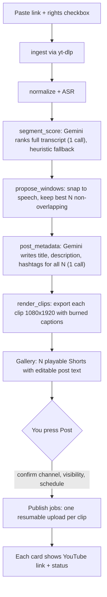

# Autopilot: link in, clips out, one-click YouTube post — R&D

**Workspace:** `/Users/apple/Desktop/Cliping`  
**Research date:** 14 November 2026  
**Decision this unblocks:** Can Cliping go from a pasted link to at least 10 finished Shorts with titles, descriptions, and hashtags, then post all of them to YouTube with one button? What has to change, and in what order?  
**Companion:** [YOUTUBE_PUBLISH_RND.md](./YOUTUBE_PUBLISH_RND.md) covers the upload API itself (OAuth, quota, Shorts rules, failure codes). This doc covers the whole flow and the Gemini part.  
**Plans:** [Phase 5 — Autopilot clips](./plans/PHASE_5_AUTOPILOT_CLIPS.md), [Phase 6 — YouTube publish](./plans/PHASE_6_YOUTUBE_PUBLISH.md).

---

## Verdict

Yes, and most of the pipeline already exists. URL ingest, transcription, ranking, speech-boundary snapping, face crop, burned captions, and 1080×1920 export all work today. What is missing is the glue:

1. The pipeline stops at `ready_for_review` with **proposals**. Each clip then needs Accept, Export, and Download, one at a time.
2. It aims for **8** clips, with no notion of “at least 10” and no warning when the source is too short.
3. Clip titles are heuristic first-sentence text. There is no post description and no hashtags.
4. Nothing talks to YouTube.

The target flow is: **paste link → wait → see 10+ rendered Shorts with Gemini-written titles, descriptions, and hashtags → fix anything you dislike → press Post → all go to your channel**, public now or spaced on a schedule.

Two hard constraints shape the design, and neither is optional:

- **YouTube API policy:** an app may *suggest* titles and descriptions, but the person must have final control, see the channel and visibility, and give express consent before uploads. The app must not append or change text after the person submits it. So Gemini writes drafts that you see and can edit, and the Post button sends exactly that text.
- **Gemini free-tier limits:** free Flash quotas are small (two independent readings in 2026 saw about **20 requests per day** on Flash and **500** on Flash-Lite; Google does not publish the numbers). So Cliping makes **one** Gemini call to rank clips and **one** call to write metadata for all clips of a video — never one call per clip.

---

## Current state, measured

From the local database on 14 November 2026 (worker in Docker, CPU, Whisper `base`):

| Source | Length | Proposals | Pipeline time | Export per clip |
| --- | --- | --- | --- | --- |
| URL, talk/entertainment | 14.3 min | 9 | ~17 min (ingest → proposals) | 11–75 s (face detect dominates when it runs) |
| URL, English lesson | 2.2 min | 7 | — | — |

`LLM_PROVIDER` is unset, so ranking is heuristic only. The `segment_score` LLM path swallows every error and silently falls back (`rank_with_llm` returns `None` on any exception), and it truncates the transcript to **14,000 characters** — roughly the first 15–20 minutes of speech. For a one-hour video, every LLM-picked clip would come from the first third.

Rough end-to-end for a 15-minute source after Phase 5: ~17 min pipeline + ~2–12 min rendering 10 clips + a few seconds of Gemini. Uploading 10 Shorts of 10–20 MB each is a minute or two on a normal connection.

---

## Target flow

Stages D–G run inside the one pipeline job, so there is one progress bar from paste to gallery. Nothing between A and H needs a click. The only gate is I.

---

## Options compared

### Where clip selection happens

| Option | Fit | Cost | Local? | Risk |
| --- | --- | --- | --- | --- |
| **Heuristics only (today)** | Works offline. Picks question/keyword windows; titles are first-sentence text. | $0 | Yes | Mediocre picks on conversational content. |
| **Gemini over the full transcript, heuristic fallback** | One request per video. Large context, so a 3-hour transcript fits. Structured JSON output. | Free tier; paid Flash ~$0.75 / $3.75 per 1M tokens in/out through 31 Dec 2026 | No (transcript leaves the machine) | Free-tier daily cap; free-tier prompts may be used to improve Google products. |
| **Ollama local model** | Already wired. | $0 | Yes | Slower, weaker on long context; still capped at 14k chars today. |
| **Send the video itself to Gemini** | Can “see” visual moments. | Many more tokens; video input on free tier is limited | No | Overkill for talking-head content; uploads the whole source. Not now. |

**Choose:** Gemini over the transcript, with the heuristic ranker as the fallback, and the fallback reason shown in the UI instead of swallowed.

### How to call Gemini

| Option | Notes |
| --- | --- |
| **Existing `openai_compatible` provider pointed at Gemini** | Works with config only: `OPENAI_BASE_URL=https://generativelanguage.googleapis.com/v1beta/openai/`, `OPENAI_API_KEY=<gemini key>`, `OPENAI_MODEL=gemini-3.8-flash`. Good for a quick ranking trial **today**. Still has the 14k-char cap and silent fallback. Google calls the compatibility layer beta. |
| **Native `generateContent` over `httpx`** | `POST https://generativelanguage.googleapis.com/v1beta/models/{model}:generateContent`, key in `x-goog-api-key`, `generationConfig.responseMimeType=application/json` plus a JSON Schema. No new dependency (`httpx` is already installed). Schema-enforced output. |
| **`google-genai` SDK** | Official; `response_json_schema` / Pydantic support. Adds a dependency for two calls. |

**Choose:** a small native client module over `httpx`, used by both the ranker and the metadata writer. Add `google-genai` only if the REST shape turns out to be painful. Do not duplicate prompt/JSON parsing between the two callers.

### Model choice (Gemini Developer API pricing page, 14 Nov 2026)

| Model id | Free tier | Paid (per 1M tokens, in / out) | Use |
| --- | --- | --- | --- |
| `gemini-3.8-flash` | Yes | $0.75 / $3.75 through 31 Dec 2026, then $1.50 / $7.50 | Default for ranking and metadata. Newest stable Flash. |
| `gemini-3.5-flash-lite` | Yes | $0.30 / $2.50 | Fallback when the Flash daily quota is spent; larger observed free quota. |
| `gemini-2.5-flash` | Deprecated | Routes to 3.5 Flash-Lite from 1 Dec 2026 | Do not pin. |

Pin an exact model id in env. Do not use `gemini-flash-latest`; Google swaps the model behind aliases.

Cost if you ever move to paid: a 1-hour transcript is roughly 15k input tokens. Ranking plus metadata for one video is on the order of 40k tokens total — about **$0.05** per video at current Flash prices.

### Free-tier budget

| Fact | Effect on design |
| --- | --- |
| Free quotas are per **project**, not per key, and Google does not publish them. Observed: Flash ~5 RPM / 20 RPD; Flash-Lite ~15 RPM / 500 RPD. | 2 calls per video → about 10 videos per day on free Flash. Show the 429 reason; do not loop. |
| Daily quotas reset at midnight Pacific. | Same reset as the YouTube Data API. |
| A 429 body names the exhausted quota (`...PerDay...FreeTier` vs `...PerMinute...`). | Per-minute: wait and retry once. Per-day: fall back immediately and say so. |
| Free tier: “content used to improve our products.” Paid tier: not used. | The transcript of every processed video goes to Google. Opt-in by setting a key; mention it in the README and next to the setting. |

---

## Metadata: what Gemini writes and what YouTube accepts

“Captions” means two different things here:

- **On-video captions** — already burned in from Whisper word timings by the export stage. Phase 3 added a text override for typos. Gemini does not touch these in Phase 5.
- **Post text** — the YouTube title, description, and hashtags. This is the new Gemini output.

One structured request per video. Input: the source title, an optional channel description from env (for example “English lessons for beginners”), the transcript language, and each clip’s id with the exact transcript text inside its window. Output schema, per clip:

| Field | Rule enforced by Cliping after Gemini responds |
| --- | --- |
| `clip_id` | Must match a clip sent in the request; unknown ids dropped. |
| `title` | Trim to **100** characters (YouTube max; the API policy also forbids a *shorter* cap in the UI). Strip `<` and `>`. Non-empty. Written in the transcript’s language. |
| `description` | 1–3 short sentences about the clip itself. Strip `<` and `>`. |
| `hashtags` | 3–5 items. Each `#` + letters/digits/underscore, no spaces, deduplicated case-insensitively. Must relate to the clip. |

Cliping then composes the **final description** once, at draft time: `description + blank line + hashtags`. That composed text is what the gallery shows and what Phase 6 uploads. Nothing is appended at upload time — that is what the YouTube developer policy forbids without consent.

YouTube rules this respects (YouTube Help, hashtags page): hashtags can sit in the title or description; up to three from the description show by the title; **more than 60** hashtags makes YouTube ignore all of them; unrelated or misleading hashtags can get the video removed; “ordinary descriptive tags or repetitive sentences” in the description are prohibited. Five relevant hashtags is well inside all of that. `#Shorts` is not needed for classification — shape and length decide that — so Cliping does not force it.

Prompt constraints worth keeping: no clickbait that the clip does not deliver, no claims the speaker did not make, no names of people unless they are said in the clip, same language as the transcript. Do not paste the JSON schema into the prompt; the schema goes in `generationConfig` (the SDK docs warn that duplicating it lowers quality).

Fallback when Gemini is off or fails: title = current heuristic title, description = empty, hashtags = empty, `post_meta_source = "fallback"`, and the gallery shows why. You can still post after filling them in.

---

## “At least 10 clips” is a function of the source

The ranker can only return as many good, non-overlapping windows as the speech allows. Asking for 10 Shorts of ~35 seconds needs roughly 6+ minutes of usable speech, and in practice a **10-minute or longer** source to avoid scraping the bottom.

Rule for Phase 5: `planned = min(requested, floor(speech_seconds / target_seconds))`, with requested default **10**. Ask Gemini for `planned + 5` candidates, validate, snap, and keep the best `planned`. If `planned < requested`, the project shows: “Source has N minutes of speech; made M clips.” Do not pad with overlapping or sub-20-second fragments to hit a number.

Autopilot clip length: **20–59 seconds**, target ~35. Staying under 60 seconds matters for Shorts: a Short **over 60 seconds** with any active copyright claim is blocked worldwide; under 60 seconds the older, milder music rules apply. Manual mode keeps today’s 5–180 second range.

---

## Rendering without clicks

Today `queue_clip_export` refuses anything not `accepted`, matching plan rule 6 (“Exports require explicit accept/export actions”). Rendering publishes nothing, though — it writes a local MP4. Phase 5 changes the rule for **autopilot projects only**: the pipeline renders the top N proposals itself, in a `render_clips` stage that reuses `run_export_clip` per clip. One failing clip marks that export failed and the stage continues; the project still reaches `ready_for_review`. You can exclude (reject) clips in the gallery before posting. Publishing still requires the Post click.

Rendering inside the pipeline job (instead of enqueueing ten `export` jobs from the worker thread) keeps one progress bar and avoids async enqueue from synchronous pipeline code. The worker runs one job at a time anyway.

---

## One-click post, made compliant

The single button is fine under YouTube’s policies if the screen it sits on shows:

- **which channel** the videos go to (developer policy: identify the channel),
- **the visibility** that will be set — public, unlisted, private, or scheduled (policy: clearly display privacy options),
- the **final text** for every clip, editable,
- a rights confirmation and the made-for-kids answer.

Then one click posts every selected clip. It counts as the “prior specific and express consent” the policy requires, because the person sees what will happen first.

Default schedule: **spaced** — first clip now, then one every 3 hours, as private videos with `publishAt` so YouTube makes each one public on time. Ten Shorts from one source landing in the same minute look like the “mass-production” pattern in YouTube’s spam policy, and spacing gives each Short its own window in the feed. “All public now” stays a visible option. Details on `publishAt`, `notifySubscribers`, quota (100 uploads/day free), and resumable upload are in [YOUTUBE_PUBLISH_RND.md](./YOUTUBE_PUBLISH_RND.md).

---

## Rights (not legal advice)

Autopilot makes it fast to repost *someone else’s* video, which is the riskiest thing this tool can do:

- Clips of another creator’s video on your channel are a copyright problem regardless of credit. Expect Content ID claims; manual takedowns lead to **strikes**, and three strikes terminate a channel.
- A claimed Short over 60 seconds is blocked worldwide — another reason for the 59-second cap.
- Reused content with little original contribution is generally not monetizable even when it stays up.
- yt-dlp against YouTube generally violates YouTube’s Terms of Service ([CLIPPING_ARCHITECTURE.md §1](./CLIPPING_ARCHITECTURE.md)). Uploading via the official API does not change that.

The publish screen keeps a required checkbox: “I own these videos or have permission to post them.” Best use: your own long videos or podcasts, clipped into Shorts for the same channel.

---

## Risks

| Risk | Mitigation |
| --- | --- |
| Gemini free quota spent mid-day | One call per stage per video; Flash-Lite fallback model; heuristic fallback with a visible reason. |
| Gemini returns bad JSON or bad times | Schema-enforced output, then the existing `validate_clips` bounds checks and speech snap. |
| Metadata goes stale after a trim | Store a hash of the clip text the metadata was written from; show “text changed — regenerate?” and a per-project Regenerate (one call). |
| Silent LLM fallback (exists today) | Record `provider_used` and `llm_error` in the job checkpoint; show it in the UI. |
| Duplicate uploads from double-click or worker restart | Publish rows keyed by export hash; resumable session URI saved before sending bytes ([YOUTUBE_PUBLISH_RND.md](./YOUTUBE_PUBLISH_RND.md)). |
| Long CPU renders | Already bounded by `max_jobs=1`; progress shows “Rendering clip k of N.” |
| Transcript privacy | Opt-in key; README states free-tier data use. |

---

## What not to build

- Posting on pipeline completion with no click.
- TikTok, Instagram, or a content calendar.
- Gemini proofreading of burned-in captions (changes timing-aligned text; revisit later).
- Video upload to Gemini for multimodal ranking.
- Thumbnails, playlists, comments, analytics feedback.
- Rotating Google projects or keys to dodge quotas.

---

## Sources

Accessed **14 November 2026**.

- [Gemini Developer API pricing](https://ai.google.dev/gemini-api/docs/pricing) — model ids, free-tier rows, paid prices, “used to improve our products” on free tier, 2.5 deprecation routing.
- [Gemini API free tier in 2026 (AI Free API)](https://www.aifreeapi.com/en/posts/google-gemini-api-free-tier) — observed free RPM/RPD per project (third-party measurements; Google does not publish them).
- [Google Gen AI SDK docs](https://googleapis.github.io/python-genai/) and [Gemini structured outputs announcement](https://blog.google/innovation-and-ai/technology/developers-tools/gemini-api-structured-outputs/) — JSON Schema output, do not repeat the schema in the prompt.
- [Gemini OpenAI compatibility](https://aistudio.google.com/docs/openai) — base URL, Bearer auth, structured output, beta status.
- [YouTube API Services Developer Policies](https://developers.google.com/youtube/terms/developer-policies) — final control over metadata, no appending without consent, identify channel and visibility, no automated uploads without express consent, 100-character title floor.
- [YouTube Spam policy](https://support.google.com/youtube/answer/2801973) — automated mass-production.
- [YouTube hashtags](https://support.google.com/youtube/answer/6390658) — placement, 3 shown by title, >60 ignored, relevance rules.
- [Three-minute Shorts](https://support.google.com/youtube/answer/15424877) — Shorts classification and the >60-second claim block.
- Local measurements from `data/cliping.db` and code read in `services/api/app/pipeline/` on 14 November 2026.
