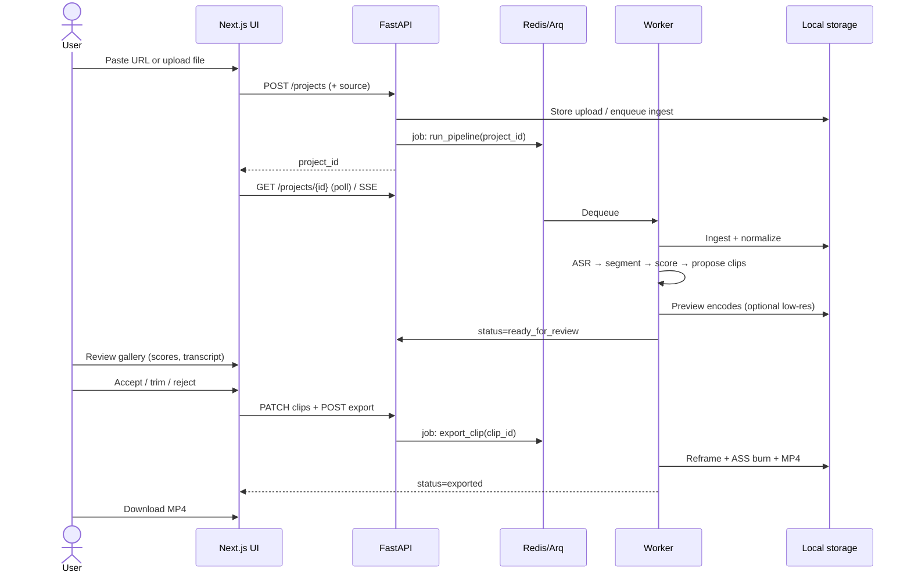
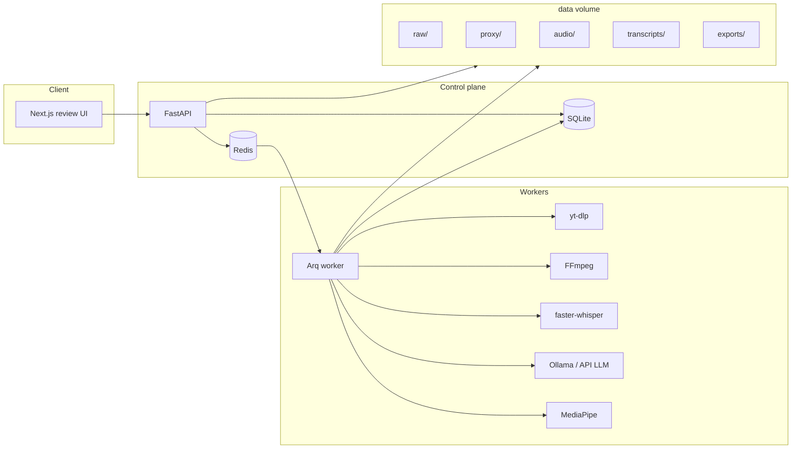
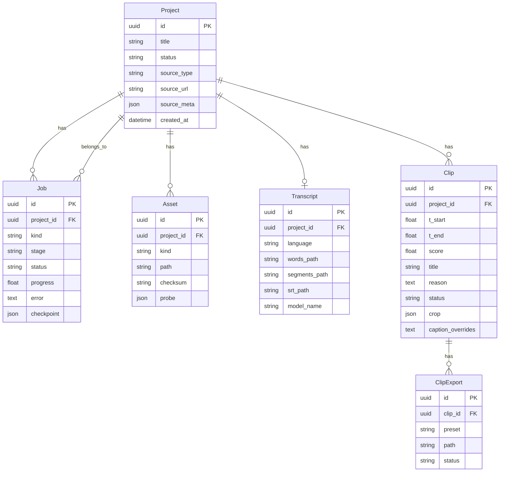
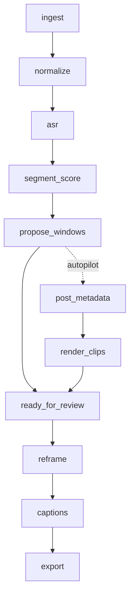
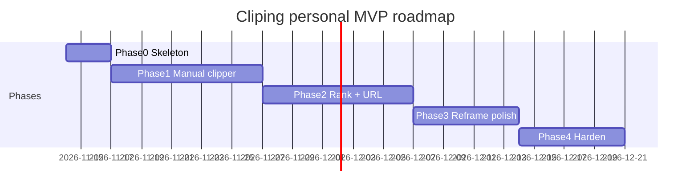

# Cliping — Architecture & Build Plan

**Workspace:** `/Users/apple/Desktop/Cliping`  
**Document date:** November 2026  
**Audience:** You (personal operator) and later implementers/agents  
**Companion research:** [CLIPPING_RND.md](./CLIPPING_RND.md) — industry pipeline, quality bar, market landscape

> **This document is implementable architecture, not code.** Follow phases in order. Defaults are opinionated so implementers do not thrash.

---

## 0. One-sentence product

Paste a YouTube URL *or* upload a local video → pipeline proposes short vertical, subtitled clips → you review → download MP4s ready for Shorts/Reels.

**Personal-use first** (single operator, local or one VPS/GPU box). Architecture stays clean enough to grow into multi-user later without a rewrite.

---

## 1. Legal / ethics / ingest reality (read first)

This is **not legal advice**. It is a product constraint so the app is designed honestly.

### 1.1 Two different risk layers

| Layer | What it is | Practical implication |
| --- | --- | --- |
| **YouTube Terms of Service** | Contract with Google. ToS generally prohibits downloading Content except as expressly authorized by YouTube (e.g. official offline features). | Using download helpers (including **yt-dlp**) against YouTube typically **violates ToS**. Consequences are contractual (account action, rare civil claims)—not “criminal by default.” |
| **Copyright** | Statute. Rights holders control reproduction and derivatives of their works. | Downloading / clipping **third-party** copyrighted video without a license can be infringement. “Personal use” is **not** a universal free pass. Re-uploading or monetizing increases risk sharply. Music beds are a common claim source (see R&D §1). |

**Product recommendation (hard default):** Prefer content **you own or have rights to** (your recordings, masters from your editor, CC-licensed sources you may use, client work under contract). Treat arbitrary public-URL clipping as a **high-risk convenience**, not the happy path.

### 1.2 Official alternatives (honest capabilities)

| Path | What you get | What you do **not** get |
| --- | --- | --- |
| **YouTube Data API v3** | Metadata (title, duration, stats), search, captions **download for videos you own** (OAuth), upload/manage | **No** full video file download API. Policy explicitly discourages storing YouTube audiovisual content without approval. Undocumented download scopes are not a public product path. |
| **OAuth / own channel** | Manage *your* uploads, captions, playlists | Still no sanctioned “give me the MP4 of this public video” endpoint. Keep your **masters** locally. |
| **Manual upload** | Full control, clearest rights story | You must have the file |
| **Google Takeout / platform export** | Export of *your* YouTube uploads | Slow; not a realtime pipeline |

### 1.3 Personal MVP ingest policy (what we will ship)

1. **First-class:** local/file upload (MP4/MOV/WebM/MKV).  
2. **Optional convenience:** URL ingest via **yt-dlp**, gated behind an explicit in-app **disclaimer** (ToS + copyright). Default config: `ALLOW_URL_INGEST=true` only on your personal machine; document the risk in UI copy.  
3. **Do not** implement DRM circumvention, login cookie harvesting guides, or bypass tooling. If a source is DRM-protected or blocked, fail cleanly and tell the user to **upload a file they have rights to**.  
4. UI copy: “You are responsible for rights to this media. Prefer uploads of content you own.”

### 1.4 Cross-link to R&D

Rights framing, fair-use caveats, and music/Content ID notes: [CLIPPING_RND.md §1](./CLIPPING_RND.md). Quality definition of “seamless + subtitled”: [§2](./CLIPPING_RND.md). Full industry pipeline stages: [§3](./CLIPPING_RND.md).

---

## 2. Product scope

### 2.1 MVP (ship this)

| In scope | Out of scope for MVP |
| --- | --- |
| Single-user local (or one-box) app | Multi-tenant SaaS, billing, orgs |
| Upload **or** URL (yt-dlp + disclaimer) | Auto-post to TikTok/IG/YouTube |
| ASR with word timestamps | Perfect multilingual / dubbing |
| Manual trim **and** LLM-ranked candidates (LLM can land in Phase 2) | Gaming kill/event detectors |
| Review UI: accept / reject / adjust in–out | Mobile native app |
| 9:16 export, burned captions, 1080×1920 H.264 | Remotion motion graphics |
| Face/center crop heuristic | Full ASD multi-cam polish |
| SQLite + local disk storage | Cloud multi-region object store |

**MVP success definition:** From a 30–90 min talking-head source you own, produce **5–10 downloadable vertical clips** with readable burned captions in under ~30–60 minutes wall time on a modern laptop (CPU) or much faster with a GPU—after a human review pass.

### 2.2 Later (growth track)

Aligned with R&D MVP stages ([CLIPPING_RND.md §7](./CLIPPING_RND.md)):

- Active speaker detection, split layouts, brand kits  
- SRT/VTT sidecar + caption QA editor  
- Autopilot: paste a link, get 10+ rendered Shorts with Gemini-drafted post text — [plans/PHASE_5_AUTOPILOT_CLIPS.md](./plans/PHASE_5_AUTOPILOT_CLIPS.md), research in [AUTOPILOT_RND.md](./AUTOPILOT_RND.md).
- YouTube publish of the reviewed batch with one explicit click — [plans/PHASE_6_YOUTUBE_PUBLISH.md](./plans/PHASE_6_YOUTUBE_PUBLISH.md), research in [YOUTUBE_PUBLISH_RND.md](./YOUTUBE_PUBLISH_RND.md).
- TikTok publish of that same batch, as its own click and its own table — [plans/PHASE_7_TIKTOK_PUBLISH.md](./plans/PHASE_7_TIKTOK_PUBLISH.md), research in [TIKTOK_PUBLISH_RND.md](./TIKTOK_PUBLISH_RND.md). Implemented. Off until `TIKTOK_CLIENT_KEY` is set. Private smoke still needs the operator's TikTok app.
- Instagram Reel publish of that same file is possible and has no paid API. Research only, no phase: [INSTAGRAM_PUBLISH_RND.md](./INSTAGRAM_PUBLISH_RND.md). It needs a professional account, a linked Facebook Page, and Facebook Login so the worker can upload the local MP4.
- Clips from a livestream that is still on air — [plans/PHASE_8_LIVESTREAM_CLIPS.md](./plans/PHASE_8_LIVESTREAM_CLIPS.md), research in [LIVESTREAM_CLIPS_RND.md](./LIVESTREAM_CLIPS_RND.md). Finished-file URL ingest does not cover this.
- Live chat as a way to transcribe only the busy seconds of that broadcast — research only, not built: [LIVE_CHAT_SPIKE_RND.md](./LIVE_CHAT_SPIKE_RND.md). Upload and finished videos stay on the current pipeline.
- A tab of public live videos — a ranked sample, not every stream. The Live card’s **Live now** tab calls `search.list` with `eventType=live` when `YOUTUBE_API_KEY` is set. Research: [YOUTUBE_LIVE_DISCOVERY_RND.md](./YOUTUBE_LIVE_DISCOVERY_RND.md).
- Social scheduling + light analytics feedback  
- Prompted “find the part about X”  
- Postgres + S3 when multi-machine or multi-user appears  

### 2.3 Explicit non-goals (MVP)

- Autopost / calendar publishing (Phase 6 is click-to-post for YouTube. Phase 7 is a separate click-to-post for TikTok. Posting without a click stays a non-goal. TikTok has no native schedule.)  
- Multi-user auth, seats, billing, usage metering  
- Gaming-specific highlight nets (Eklipse-class)  
- Mobile apps  
- “One-click viral guarantee” scoring theater without review  
- Circumventing DRM / platform security features  
- Scraping private or age-gated content via stolen sessions  

---

## 3. Recommended stack (opinionated default)

### 3.1 Primary recommendation — **we will use this**

| Layer | Choice | Why |
| --- | --- | --- |
| **API** | **Python 3.12 + FastAPI** | Best ecosystem for Whisper, FFmpeg wrappers, yt-dlp; async-friendly HTTP |
| **Queue** | **Redis + Arq** | Native asyncio; simple; `max_jobs=1` fits CPU/GPU-bound media; easier than Celery for personal scale |
| **DB** | **SQLite** (SQLAlchemy 2 + Alembic) | Zero ops for personal use; migrate to Postgres later with same models |
| **Storage** | **Local filesystem** (`data/` volume) | Personal box; swap to S3/R2 later behind a storage interface |
| **Media** | **FFmpeg** (system binary) | Normalize, cut, crop, loudnorm, burn ASS |
| **ASR** | **faster-whisper** (`large-v3-turbo` default; `medium` on weak CPU) | Fast CTranslate2; `word_timestamps=True` good enough for v1 captions |
| **Alignment upgrade** | **WhisperX** (optional Phase 2+) | Tighter word times + optional diarization when karaoke captions need it |
| **LLM ranking** | **Ollama** local (e.g. `llama3.1:8b` / `qwen2.5:14b`) **or** OpenAI-compatible API | JSON clip windows; keep prompt + schema in-repo |
| **Faces (v1)** | **MediaPipe Face Detection** (or OpenCV YuNet) | Static/median crop center; good enough for talking-head |
| **UI** | **Next.js 15 (App Router) + TypeScript** | Review gallery, upload, job progress; polls or SSE |
| **Captions** | Generate **ASS** (karaoke-style) → FFmpeg `ass` filter burn-in; also keep **SRT** | Matches short-form mute-autoplay expectation ([R&D §8](./CLIPPING_RND.md)) |
| **Deploy** | **Docker Compose** on laptop or single VPS | One `docker compose up` personal stack |

**Process model:** FastAPI never runs Whisper/FFmpeg inline for long jobs. It creates DB rows, enqueues Arq jobs, returns IDs. Workers own the pipeline. One media job at a time per worker (`max_jobs=1`) to avoid CPU thrash.

### 3.2 Alternatives (if you diverge)

| Concern | Alternative | Tradeoff |
| --- | --- | --- |
| Queue | RQ / Celery | Fine; more sync/broker complexity for little gain at N=1 user |
| Queue (zero Redis) | Filesystem job folder + watchdog | Fewer deps; weaker retries/visibility |
| UI | Minimal HTMX/Jinja in FastAPI | Faster to ship Phase 0; harder rich review UX |
| ASR | OpenAI Whisper API / Deepgram / AssemblyAI | Pay-per-minute; best when you hate local models |
| LLM | Claude / GPT only | Better ranking; recurring cost; needs network |
| Render | Remotion later | Beautiful templates; Node+Chromium weight—**after** FFmpeg path works |
| DB | Postgres from day one | Better if you already run Postgres; overkill for solo |

### 3.3 Hardware assumptions

| Profile | Expectation |
| --- | --- |
| **CPU-only laptop** (Apple Silicon or recent x86, 16–32 GB RAM) | Viable for personal volumes; use `medium` or `large-v3-turbo` int8; hour-long ASR may take 20–90+ min |
| **NVIDIA GPU box** (8+ GB VRAM) | Comfortable `large-v3` / turbo fp16; much faster ASR + encode |
| **Disk** | Budget **3–5×** source size during a job (original + proxy + wav + intermediates + exports); keep ≥50 GB free for hour-long HD sources |

---

## 4. User flow

### 4.1 Happy path



### 4.2 Review gate (required)

AI proposes; **you always approve** before treating a clip as final. No silent auto-publish. This matches industry consensus in [CLIPPING_RND.md §1 / §5](./CLIPPING_RND.md).

---

## 5. System architecture



### 5.1 Component responsibilities

| Component | Owns |
| --- | --- |
| **UI** | Create project, show progress, transcript-linked review, trim, caption typo fix (later), download |
| **API** | Validation, auth-lite (optional local token), CRUD, enqueue, signed/static file serving for media |
| **Worker** | Pipeline stages, retries, progress events, idempotent stage checkpoints |
| **SQLite** | Projects, jobs, clips, transcripts metadata, asset paths |
| **Filesystem** | Blobs; DB stores paths + checksums |
| **Redis** | Queue + optional pub/sub for SSE progress |

### 5.2 Storage layout (on disk)

```text
data/
  projects/{project_id}/
    raw/           # original download or upload
    proxy/         # 720p H.264 for preview/ML
    audio/         # 16 kHz mono WAV for ASR
    transcripts/   # words.json, segments.json, srt
    clips/{clip_id}/
      preview.mp4  # optional cheap preview
      captions.ass
      captions.srt
      export.mp4   # final 1080x1920
    meta/          # ffprobe.json, source.json
```

---

## 6. Data model

SQLAlchemy-style logical schema. UUIDs as strings. Timestamps UTC.

### 6.1 Entity overview



### 6.2 Tables & fields

#### `projects`

| Field | Type | Notes |
| --- | --- | --- |
| `id` | UUID PK | |
| `title` | str | From filename / YouTube title / user edit |
| `status` | enum | `created`, `ingesting`, `processing`, `live`, `ready_for_review`, `exporting`, `done`, `failed` |
| `source_type` | enum | `upload`, `url`, `live` |
| `source_url` | str nullable | Original URL if any |
| `source_meta` | JSON | title, duration, uploader, webpage_url, disclaimer_accepted_at |
| `target_clip_count` | int | default 8 |
| `target_duration_sec` | int | default 45 (range 20–60) |
| `created_at` / `updated_at` | datetime | |

#### `jobs`

| Field | Type | Notes |
| --- | --- | --- |
| `id` | UUID PK | Also Arq job correlation id |
| `project_id` | FK | |
| `kind` | enum | `pipeline`, `export`, `retranscribe` |
| `stage` | str | Current stage name (see §7) |
| `status` | enum | `queued`, `running`, `succeeded`, `failed`, `cancelled` |
| `progress` | float 0–1 | |
| `error` | text | Last error message |
| `checkpoint` | JSON | Completed stages + artifact paths for idempotent resume |
| `created_at` / `started_at` / `finished_at` | datetime | |

#### `assets`

| Field | Type | Notes |
| --- | --- | --- |
| `id` | UUID PK | |
| `project_id` | FK | |
| `kind` | enum | `raw`, `proxy`, `audio_wav`, `preview`, `other` |
| `path` | str | Relative to `data/` |
| `checksum` | str | sha256 |
| `bytes` | int | |
| `probe` | JSON | ffprobe streams/duration/fps/size |

#### `transcripts`

| Field | Type | Notes |
| --- | --- | --- |
| `id` | UUID PK | |
| `project_id` | FK unique | One active transcript per project for MVP |
| `language` | str | ISO code |
| `model_name` | str | e.g. `faster-whisper/large-v3-turbo` |
| `words_path` | str | JSON: `[{word,start,end,prob?}]` |
| `segments_path` | str | Sentence/segment level |
| `srt_path` | str | Full-episode SRT |
| `created_at` | datetime | |

#### `clips`

| Field | Type | Notes |
| --- | --- | --- |
| `id` | UUID PK | |
| `project_id` | FK | |
| `rank` | int | Display order |
| `t_start` / `t_end` | float sec | Snapped to speech boundaries |
| `score` | float | 0–100 heuristic/LLM |
| `title` | str | Hook title for on-screen / filename |
| `reason` | text | “Why this clip” |
| `status` | enum | `proposed`, `accepted`, `rejected`, `exported` |
| `crop` | JSON | `{mode, x, y, w, h}` or timeline of crop centers |
| `caption_text_override` | text nullable | Manual fixes |
| `user_t_start` / `user_t_end` | float nullable | After human trim |

#### `clip_exports`

| Field | Type | Notes |
| --- | --- | --- |
| `id` | UUID PK | |
| `clip_id` | FK | |
| `preset` | enum | `shorts_1080`, `reels_1080` (same encode for MVP) |
| `path` | str | |
| `status` | enum | `pending`, `rendering`, `ready`, `failed` |
| `width` / `height` / `duration_sec` | int/float | |
| `created_at` | datetime | |

---

## 7. Pipeline stages (implementable)

Each stage is a **pure-ish function** with filesystem inputs/outputs. Persist completion in `jobs.checkpoint` so retries skip done work.

**Global idempotency rule:** If output artifact exists and checksum matches expected inputs (or checkpoint flag set), skip stage.



> Stages 0–4 run as one `pipeline` job. Stages 6–8 run per accepted clip as `export` jobs (reframe may be precomputed as preview in Phase 2).
>
> **Autopilot (Phase 5):** when `projects.autopilot` is true the same `pipeline` job continues with `post_metadata` (one Gemini call drafts title, description, and hashtags for every kept clip; fallback drafts without a key) and `render_clips` (reuses the export core for each kept clip in rank order; a failed clip is recorded and skipped). Autopilot clips are 20–59 s (`AUTOPILOT_CLIP_MIN_SEC` / `AUTOPILOT_CLIP_MAX_SEC`), non-overlapping, and capped at `min(requested, floor(speech_seconds / AUTOPILOT_TARGET_SEC))`. Manual projects stop at `propose_windows` as before.

### 7.1 `ingest`

| | |
| --- | --- |
| **Inputs** | `source_type`, upload path **or** URL + `disclaimer_accepted` |
| **Outputs** | `assets(raw)`, `source_meta` |
| **Tools** | Upload: shutil into `raw/`. URL: **yt-dlp** (best video+audio merge), with length/size caps |
| **Failure modes** | Geo/login walls, unavailable video, disk full, user denied disclaimer, unsupported site |
| **Idempotency** | If `raw/` exists and meta matches URL/upload checksum, skip |
| **Guards** | Max duration (e.g. 3h), max bytes (e.g. 8 GB), refuse DRM-protected / explicit “download unavailable” with clear error—**no bypass** |

**Disclaimer record:** store `disclaimer_accepted_at` in `source_meta` when URL ingest used.

**Live broadcasts:** this stage expects a finished file with a finite duration. A YouTube stream that is still on air does not take this path. Live capture is a separate process (`ALLOW_LIVE_INGEST`, default off) that cuts closed windows and then runs this same pipeline on each window. It does not follow inside `download_url`. See [LIVESTREAM_CLIPS_RND.md](./LIVESTREAM_CLIPS_RND.md). A later idea, not built, is to cut only ranges where live chat spiked: [LIVE_CHAT_SPIKE_RND.md](./LIVE_CHAT_SPIKE_RND.md).

### 7.2 `normalize`

| | |
| --- | --- |
| **Inputs** | raw video |
| **Outputs** | `proxy/` 1280×720 (or source height if lower) H.264 yuv420p; `audio/` 16 kHz mono PCM WAV; `ffprobe.json` |
| **Tools** | FFmpeg |
| **Failure modes** | Corrupt container, missing audio stream, exotic codecs |
| **Idempotency** | Skip if proxy+wav exist and raw checksum unchanged |
| **Notes** | Keep raw for final quality cut; do ASR on wav; previews on proxy |

Example intent (not a copy-paste production script):

- Proxy: scale to 720p, AAC or strip audio if unused  
- WAV: `-ac 1 -ar 16000`

### 7.3 `asr`

| | |
| --- | --- |
| **Inputs** | WAV |
| **Outputs** | `words.json`, `segments.json`, full `episode.srt`, `transcripts` row |
| **Tools** | **faster-whisper** with `word_timestamps=True`; language auto or forced `en` |
| **Model default** | `large-v3-turbo` on GPU/Apple if feasible; else `medium` int8 on CPU |
| **Failure modes** | OOM, hallucinated silence, wrong language, music-only segments |
| **Idempotency** | Skip if words.json exists for same model+wav checksum |
| **Quality gate** | Spot-check proper nouns later in UI; never trust ASR blindly ([R&D §3](./CLIPPING_RND.md)) |

**Optional later:** WhisperX alignment pass for tighter karaoke; pyannote diarization for multi-speaker.

### 7.4 `segment_score`

| | |
| --- | --- |
| **Inputs** | segments/words; optional chapter markers from description |
| **Outputs** | Candidate spans with scores + reasons (JSON) |
| **Tools** | **Phase 1:** heuristics (questions, exclamations, pause boundaries, keyword boosts). **Phase 2:** LLM with strict JSON schema via Ollama/API |
| **Failure modes** | LLM invalid JSON, overlapping windows, empty candidates |
| **Idempotency** | Cache `candidates.json` keyed by transcript checksum + prompt version |
| **Heuristics that still matter** | Prefer sentence starts; penalize mid-clause ends; boost Q→A; avoid pure silence/ads ([R&D §5](./CLIPPING_RND.md)) |

**LLM output schema (conceptual):**

```json
{
  "clips": [
    {
      "start_sec": 120.4,
      "end_sec": 162.1,
      "score": 87,
      "title": "Why most founders quit too early",
      "reason": "Clear claim + concrete story payoff"
    }
  ]
}
```

Validate: duration in `[min,max]`, `end > start`, non-overlapping (or max overlap 5s), within media duration.

### 7.5 `propose_windows` (speech-boundary snap)

| | |
| --- | --- |
| **Inputs** | Candidate spans + word timestamps |
| **Outputs** | `clips` rows status=`proposed` |
| **Tools** | Pure Python snap: move start to previous silence/word boundary ≥ gap threshold; end to next boundary; pad ±150–300 ms |
| **Failure modes** | No nearby silence; words missing timestamps |
| **Idempotency** | Replace proposed clips only if `candidates.json` hash changed; never clobber `accepted`/`exported` |
| **Rule** | Never start mid-word; prefer pause > 250 ms |

### 7.6 `reframe` (9:16)

| | |
| --- | --- |
| **Inputs** | Accepted clip window + proxy/raw |
| **Outputs** | Crop parameters; optional preview MP4 |
| **Tools v1** | MediaPipe faces on sampled frames → median center → `crop=W:H:X:Y` with 9:16 window on source; fallback **center crop** |
| **Tools later** | Tracking / ASD / split layouts |
| **Failure modes** | No face (screen share), multi-face ping-pong, vertical already |
| **Idempotency** | Store crop JSON on clip; recompute only if forced |
| **Hard cases** | Document fallback UI: “center / left / right / custom” override ([R&D §6](./CLIPPING_RND.md)) |

### 7.7 `captions` (styled burn package)

| | |
| --- | --- |
| **Inputs** | Words in `[t_start,t_end]` (use midpoint membership); optional overrides |
| **Outputs** | Clip-relative `captions.srt`, `captions.ass` |
| **Tools** | Custom ASS generator (1–4 words/page, `\k` karaoke); FFmpeg burn on export |
| **Style defaults** | Heavy sans, white fill, black outline, lower-center **inside safe zone** (~avoid bottom ~420px / top ~240px / right ~200px on 1080×1920—verify on device; [R&D §6](./CLIPPING_RND.md)) |
| **Failure modes** | Times not shifted to clip-zero; pages too long; empty words |
| **Idempotency** | Regenerate when trim or override changes |

### 7.8 `export`

| | |
| --- | --- |
| **Inputs** | Raw (preferred) or proxy, crop, ASS, trim |
| **Outputs** | `export.mp4` 1080×1920, H.264 + AAC, ~30 fps (or source fps), loudnorm optional |
| **Tools** | FFmpeg filter graph: trim → crop/scale → ass → encode |
| **Presets** | `shorts_1080` / `reels_1080` identical for MVP |
| **Failure modes** | Filter graph syntax, font missing for ASS, audio desync |
| **Idempotency** | Skip if export exists and inputs hash unchanged |

**“Seamless” checklist for export QA:** clean in/out on speech, stable crop, captions readable muted, no letterboxing, audio clear.

---

## 8. API surface (REST sketch)

Base: `/api/v1`. JSON. Personal MVP: optional shared `API_TOKEN` header; no multi-user accounts.

| Method | Path | Purpose |
| --- | --- | --- |
| `GET` | `/health` | Liveness |
| `POST` | `/projects` | Create project (multipart upload **or** `{url, disclaimer_accepted, title?, autopilot?, clip_count?}`) |
| `POST` | `/projects/{id}/post-metadata` | Redraft post text for clips the user has not edited (one Gemini call) |
| `GET` | `/projects` | List recent projects |
| `GET` | `/projects/{id}` | Detail + status + progress |
| `DELETE` | `/projects/{id}` | Delete project + files |
| `POST` | `/projects/{id}/reprocess` | Re-run pipeline from stage (body: `from_stage`) |
| `GET` | `/projects/{id}/transcript` | Words/segments URLs or inline for short |
| `GET` | `/projects/{id}/clips` | Proposed/accepted clips |
| `PATCH` | `/clips/{id}` | Update status, trims, title, crop, caption override, `post_title` / `post_description` / `post_hashtags` |
| `POST` | `/clips/{id}/export` | Enqueue export |
| `GET` | `/clips/{id}/exports` | Export status + download path |
| `GET` | `/files/{project_id}/...` | Auth-gated static media (or nginx alias in compose) |
| `GET` | `/projects/{id}/events` | SSE progress stream (optional; poll is fine for MVP) |
| `GET` | `/youtube/status` | Connected or not, and the channel name when the upload scope allows it |
| `GET` | `/youtube/connect` | Redirect to Google consent (`youtube.upload`, offline) |
| `GET` | `/youtube/callback` | Store the refresh token and redirect back to the web app |
| `POST` | `/youtube/disconnect` | Revoke the token and delete the local file |
| `POST` | `/projects/{id}/publish` | Snapshot the shown text and enqueue one upload per selected clip |
| `GET` | `/projects/{id}/publishes` | Per-clip upload status. The resumable session URI is not returned |

**Create project response:** `{ id, status }` immediately; processing async.

**Error shape:** `{ "error": { "code": "INGEST_FAILED", "message": "..." } }`

---

## 9. Proposed monorepo structure

```text
Cliping/
  docs/
    CLIPPING_RND.md
    CLIPPING_ARCHITECTURE.md   # this file
  apps/
    web/                       # Next.js UI
      package.json
      src/app/...
  services/
    api/                       # FastAPI
      pyproject.toml
      app/
        main.py
        api/routes/
        models/
        schemas/
        services/
        db/
    worker/                    # Arq worker (can share package with api)
      app/
        worker.py
        pipeline/
          ingest.py
          normalize.py
          asr.py
          score.py
          windows.py
          reframe.py
          captions.py
          export.py
        llm/
        vision/
  packages/
    shared/                    # optional shared types / prompts
  data/                        # gitignored runtime volume
  models/                      # gitignored Whisper weights cache
  docker-compose.yml
  .env.example
  README.md
```

**Python packaging note:** Prefer one `services/backend` package imported by both API and worker to avoid drift; split processes only at entrypoints (`uvicorn`, `arq`).

---

## 10. Local vs cloud deployment

### 10.1 Docker Compose (personal machine) — sketch

```yaml
# Conceptual — refine during Phase 0
services:
  redis:
    image: redis:7-alpine
    ports: ["6379:6379"]

  api:
    build: ./services/api
    env_file: .env
    ports: ["8000:8000"]
    volumes:
      - ./data:/data
      - ./models:/models
    depends_on: [redis]

  worker:
    build: ./services/api   # same image, different command
    command: arq app.worker.WorkerSettings
    env_file: .env
    volumes:
      - ./data:/data
      - ./models:/models
    depends_on: [redis]
    # deploy.resources for GPU when available
    # gpus: all

  web:
    build: ./apps/web
    ports: ["3000:3000"]
    environment:
      NEXT_PUBLIC_API_URL: http://localhost:8000
    depends_on: [api]
```

**Host dependencies alternative (dev):** Homebrew `ffmpeg`, local Redis, `uvicorn` + `arq` in a venv—often faster iteration than rebuilding GPU images.

### 10.2 Single VPS / GPU box

- Same compose; attach NVIDIA Container Toolkit if GPU.  
- Reverse proxy (Caddy/nginx) with basic auth or Tailscale-only bind—**do not** expose URL-ingest publicly without auth.  
- Persist `data/` and `models/` on a large volume.

### 10.3 What stays local by default

Whisper weights, source videos, exports. Optional: call cloud LLM/ASR only via env flags.

---

## 11. Config / secrets

### 11.1 `.env.example` (canonical keys)

| Variable | Example | Purpose |
| --- | --- | --- |
| `DATA_DIR` | `/data` | Project files root |
| `DATABASE_URL` | `sqlite+aiosqlite:////data/cliping.db` | DB |
| `REDIS_URL` | `redis://redis:6379/0` | Queue |
| `API_TOKEN` | random | Simple lock for personal deploy. Empty disables the check. |
| `STORAGE_BACKEND` | `local` | `local` (default) or `s3` stub |
| `S3_BUCKET` / `S3_REGION` / `S3_PREFIX` / `S3_ENDPOINT_URL` | | Reserved. Unused while backend is `local`. |
| `MIN_FREE_BYTES` | `1073741824` | Free-space floor before ingest. `0` disables it. |
| `CLEANUP_MAX_AGE_DAYS` | `7` | Age for proxy and failed-project cleanup |
| `CLEANUP_DELETE_PROXY` | `false` | Also delete old `proxy.mp4` files |
| `WATERMARK_TEXT` / `WATERMARK_IMAGE` | empty | Optional export watermark. Off by default. |
| `CLIPING_API_URL` | `http://api:8000` | Next server upstream (not the browser) |
| `CLIPING_API_TOKEN` | same as `API_TOKEN` | Next server only. Do not use `NEXT_PUBLIC_`. |
| `ALLOW_URL_INGEST` | `true` | Enable yt-dlp path |
| `ALLOW_LIVE_INGEST` | `false` | Live capture. Off until set. A YouTube live URL also needs `ALLOW_URL_INGEST`. |
| `LIVE_CHUNK_SEC` | `300` | Closed window length |
| `LIVE_CHUNK_OVERLAP_SEC` | `20` | Overlap so a sentence on the boundary can be snapped |
| `LIVE_EDGE_LAG_SEC` | `20` | Do not cut this close to the growing file |
| `LIVE_MAX_HOURS` | `8` | Stop capture after this many hours |
| `LIVE_FOLDER_ROOT` | empty | Extra directory root for folder mode. `DATA_DIR` is always allowed. |
| `LIVE_STALL_SEC` | `180` | Stop a YouTube follow that stops growing |
| `LIVE_FOLDER_STABLE_SEC` | `10` | A folder file is a window after its size stays the same this long |
| `MAX_SOURCE_DURATION_SEC` | `43200` | 12h cap |
| `MAX_SOURCE_BYTES` | `8589934592` | 8 GB |
| `WHISPER_MODEL` | `large-v3-turbo` | ASR model id |
| `WHISPER_DEVICE` | `auto` | `cpu` / `cuda` / `auto` |
| `WHISPER_COMPUTE_TYPE` | `auto` | `int8` / `float16` |
| `WHISPER_MODEL_DIR` | `/models/whisper` | Cache |
| `LLM_PROVIDER` | `ollama` | `ollama` \| `openai_compatible` \| `gemini` \| `none` |
| `GEMINI_API_KEY` | | Google AI Studio key. Optional; never logged. Also enables Gemini post text. |
| `GEMINI_MODEL` / `GEMINI_FALLBACK_MODEL` | `gemini-3.8-flash` / `gemini-3.5-flash-lite` | Pinned ids; fallback is tried once when the daily quota is spent |
| `GEMINI_TIMEOUT_SEC` | `90` | |
| `GEMINI_MAX_TRANSCRIPT_CHARS` | `300000` | Gemini ranking only; other providers keep 14,000 |
| `CHANNEL_CONTEXT` | | One line about the channel for the post-text prompt |
| `AUTOPILOT_CLIP_COUNT` | `10` | Default requested clips for autopilot |
| `AUTOPILOT_CLIP_MIN_SEC` / `AUTOPILOT_CLIP_MAX_SEC` | `20` / `59` | Autopilot bounds (under 60 s for Shorts claim rules) |
| `AUTOPILOT_TARGET_SEC` | `35` | Target length; also the speech-per-clip rule |
| `OLLAMA_BASE_URL` | `http://host.docker.internal:11434` | Local LLM |
| `OLLAMA_MODEL` | `llama3.1:8b` | Ranking model |
| `OPENAI_API_KEY` | | Only if cloud LLM/ASR |
| `OPENAI_BASE_URL` | | Optional compatible endpoint |
| `TARGET_CLIP_COUNT` | `8` | Default proposals |
| `CLIP_MIN_SEC` / `CLIP_MAX_SEC` | `20` / `60` | Window bounds |
| `EXPORT_WIDTH` / `EXPORT_HEIGHT` | `1080` / `1920` | |
| `FFMPEG_PATH` | `ffmpeg` | Binary |
| `YT_DLP_PATH` | `yt-dlp` | Binary |
| `CORS_ORIGINS` | `http://localhost:3000` | |
| `YOUTUBE_API_KEY` | empty | Live now tab. Free Data API key. Off when empty. Never logged. |
| `YOUTUBE_CLIENT_ID` / `YOUTUBE_CLIENT_SECRET` | empty | YouTube posting stays off when the id is empty. Never log the secret. |
| `YOUTUBE_REDIRECT_URI` | `http://localhost:3000/api/backend/api/v1/youtube/callback` | Must match the Google OAuth client. Goes through the web proxy so `API_TOKEN` still applies. |
| `YOUTUBE_CATEGORY_ID` | `22` | Checked once with `videoCategories.list`. People & Blogs. |
| `YOUTUBE_DEFAULT_SPACING_MIN` | `180` | Default gap for a spaced batch |

**Secrets:** never commit `.env`. No need for cloud credentials if fully local (Ollama + Whisper + upload-only). The YouTube refresh token lives at `DATA_DIR/secrets/youtube_token.json` (mode `0600`), is not under `/files`, and is never logged. The resumable session URI is stored on the publish row and is not returned by the API.

---

## 12. Quality gates (“good enough for personal use”)

### 12.1 Automated (cheap)

| Gate | Pass criteria |
| --- | --- |
| Ingest | Duration/size within caps; has audio stream |
| ASR | Non-empty words; language confidence above threshold or user override |
| Candidates | ≥ N clips (or best-effort with warning); valid JSON; within bounds |
| Export | ffprobe: 1080×1920, has aac+h264, duration ≈ trim length ±0.25s |

### 12.2 Human review UI (required)

Minimum review surface:

1. **Gallery** of candidates sorted by score with title + reason  
2. **Video player** scrubbed to window; show in/out  
3. **Transcript pane** with highlighted span; drag handles snap to words  
4. **Accept / reject**; edit title  
5. **Crop mode** toggle: face / center / left / right  
6. **Export** button → download when ready  
7. Show **pipeline progress** and errors without silent failure  

**Personal “done” bar:** You would post ≥30% of accepted clips with only light trim and occasional caption typo fixes (aligns with R&D MVP-1 metric).

### 12.3 Caption quality

Wrong words > slightly late cuts for trust. Always allow override path before export (Phase 2 can add inline edit).

---

## 13. Phased build plan

**Executable agent playbooks (task-level):** [plans/README.md](./plans/README.md) — Phase 0–4 docs with tasks, exit criteria, and parallelization notes. Prefer those when implementing.

Ship usefulness early: **upload + manual in/out + captions before fancy AI ranking.**

### Phase 0 — Skeleton (days)

**Build:** monorepo, Compose, FastAPI health, SQLite models, Next.js shell, shared `DATA_DIR`, FFmpeg version check.

**Done when:** `docker compose up` shows API health + empty UI; DB migrates; can write a test file into `data/`.

### Phase 1 — Manual clipper (first useful product)

**Build:** upload ingest; normalize; ASR (faster-whisper); UI to pick start/end on transcript; center/face crop; ASS+SRT; export 9:16 MP4.

**Done when:** You can upload a podcast MP4 you own and download a vertical subtitled clip without any LLM or URL ingest.

### Phase 2 — Proposals + URL convenience

**Build:** heuristic + LLM ranking; speech-boundary snap; review gallery; yt-dlp URL ingest + disclaimer; job progress SSE/poll; resume checkpoints.

**Done when:** Paste (or upload) → ≥5 proposed clips → accept 2 → export both; URL path shows legal disclaimer and records acceptance.

### Phase 3 — Reframe & caption polish

**Build:** MediaPipe median face crop; crop overrides; karaoke ASS tuning; loudnorm; WhisperX optional; caption override field; delete/reprocess stages.

**Done when:** Talking-head faces stay framed on 3 test videos; captions sit in safe zone; re-export after trim works idempotently.

### Phase 4 — Hardening & growth hooks

**Build:** storage interface (local → S3-ready), Postgres optional flag, basic auth for VPS, cleanup job for failed temps, metrics logs, brand watermark optional, Remotion spike **only if** FFmpeg style is insufficient.

**Done when:** One-box VPS deploy behind Tailscale/auth survives a 2-hour source end-to-end; README documents ops; architecture still matches this doc.



*(Dates illustrative; start whenever you begin Phase 0.)*

---

## 14. Cost & hardware (1-hour source → 5–10 clips)

Rough **order-of-magnitude** for personal use (Nov 2026):

| Resource | CPU-only (modern laptop) | GPU (e.g. 8–12 GB NVIDIA) |
| --- | --- | --- |
| **Disk peak** | ~8–20 GB working set for 1080p hour + proxies/exports | Same |
| **ASR** | ~0.3–1.5× realtime depending on model/threads (turbo/medium) | Often ≪0.1–0.3× realtime |
| **LLM rank** | Local Ollama: minutes; or ~$0.01–0.10 API for transcript chunk | Same |
| **Encode** | 5–10 clips × 30–60s: minutes each on CPU | Much faster with NVENC if configured |
| **$ cloud** | **$0** if fully local | Electricity; optional API cents |

**Whisper model sizes (approx download):** tiny/base small; `medium` ~1.5 GB; `large-v3` / turbo several GB—cache under `models/`.

**Throughput advice:** For personal weekly podcasts, CPU is acceptable. Buy/borrow GPU only if you hate waiting or process multi-hour weekly volume.

---

## 15. Risks & mitigations

| Risk | Impact | Mitigation |
| --- | --- | --- |
| **YouTube ToS / copyright** | Account/legal risk; unethical third-party clipping | Prefer uploads of owned content; disclaimer; no DRM bypass; document risks in UI |
| **ASR errors** | Bad captions destroy trust | Human review; caption overrides; WhisperX later; spell-check names |
| **Bad vertical crops** | Unusable clips | Face median + manual override; center fallback |
| **Queue/worker crash mid-job** | Lost hours | Checkpoint per stage; idempotent skip; reprocess endpoint |
| **Large files / disk full** | Hard fail mid-pipeline | Caps; disk free-space check pre-ingest; cleanup temps |
| **LLM junk proposals** | Wasted review time | Heuristic baseline; strict schema validation; always human gate |
| **yt-dlp breakage** | URL path flakes as sites change | Treat URL as best-effort; upload is source of truth |
| **Font/ASS issues in Docker** | Missing captions | Bundle fonts; smoke-test burn-in in CI/script |

---

## 16. Testing strategy (lightweight)

| Level | What |
| --- | --- |
| **Unit** | Boundary snap, ASS page packing, JSON schema validation |
| **Fixture** | 60s talking-head sample (your own) checked into `testdata/` or downloaded under license |
| **Smoke** | Script: normalize → fake words → export graph produces 1080×1920 |
| **Manual** | Phase exit criteria above |

No need for heavy e2e framework in Phase 0–1.

---

## 17. Security notes (personal deploy)

- Bind to localhost or Tailscale; if public, require `API_TOKEN` / basic auth  
- Do not log full source URLs with tokens  
- Path traversal guard on `/files/...`  
- Treat yt-dlp output as untrusted binary input to FFmpeg (already normal media hygiene)  
- No multi-tenant isolation required until you add users  
- YouTube refresh token: `DATA_DIR/secrets/youtube_token.json`, mode `0600`, never logged, never served by `/files`  

---

## 18. Decision log (defaults locked)

| Decision | Choice |
| --- | --- |
| Language/runtime | Python FastAPI + Arq workers |
| UI | Next.js |
| DB | SQLite → Postgres when needed |
| ASR | faster-whisper first |
| Ranker | Heuristics → Ollama/API LLM; Gemini optional from Phase 5 (one call per video, visible fallback) |
| Post metadata | Gemini drafts title, description, hashtags (Phase 5); operator edits; sent unchanged |
| Render | FFmpeg ASS burn-in; autopilot projects render without an Accept click |
| Ingest | Upload first-class; yt-dlp optional with disclaimer |
| Review | Always human-in-the-loop before anything leaves the machine as a post |
| Publish | YouTube Data API resumable `videos.insert` after one explicit click. Off when `YOUTUBE_CLIENT_ID` is empty. Never on export completion. |
| TikTok publish | Separate from YouTube. Direct Post `FILE_UPLOAD` after one explicit click. Off when `TIKTOK_CLIENT_KEY` is empty. An unaudited app posts Only me to a private account. Playbook: [plans/PHASE_7_TIKTOK_PUBLISH.md](./plans/PHASE_7_TIKTOK_PUBLISH.md). |

---

## 19. First implementation ticket (suggested)

**Ticket: Phase 1 vertical slice — “Upload → Whisper words → manual trim → center-crop 9:16 → burned captions MP4”**

Acceptance criteria:

1. `POST /projects` accepts an MP4 upload.  
2. Worker produces WAV + `words.json`.  
3. UI shows transcript; user sets in/out.  
4. `POST /clips/{id}/export` writes `1080x1920` MP4 with burned captions.  
5. README: how to run API+worker+FFmpeg locally (Compose optional).  
6. No URL ingest yet; no LLM yet.

This ships a tool you can use on **your own files** immediately, then Phase 2 adds ranking + URL convenience.

---

## 20. Cross-references

| Topic | Where |
| --- | --- |
| What “proper clips” means | [CLIPPING_RND.md §2](./CLIPPING_RND.md) |
| Industry 12-stage pipeline | [CLIPPING_RND.md §3](./CLIPPING_RND.md) |
| SaaS landscape / DIY tools | [CLIPPING_RND.md §4](./CLIPPING_RND.md) |
| AI under the hood + HITL | [CLIPPING_RND.md §5](./CLIPPING_RND.md) |
| Caption safe zones / hooks | [CLIPPING_RND.md §6](./CLIPPING_RND.md) |
| Build-vs-buy MVP stages | [CLIPPING_RND.md §7](./CLIPPING_RND.md) |
| YouTube publish after export | [YOUTUBE_PUBLISH_RND.md](./YOUTUBE_PUBLISH_RND.md) |
| TikTok publish after export | [TIKTOK_PUBLISH_RND.md](./TIKTOK_PUBLISH_RND.md) |
| Instagram publish after export | [INSTAGRAM_PUBLISH_RND.md](./INSTAGRAM_PUBLISH_RND.md) |
| Autopilot flow + Gemini metadata | [AUTOPILOT_RND.md](./AUTOPILOT_RND.md) |

---

*End of architecture document. Implement in phase order; do not skip the human review gate.*
