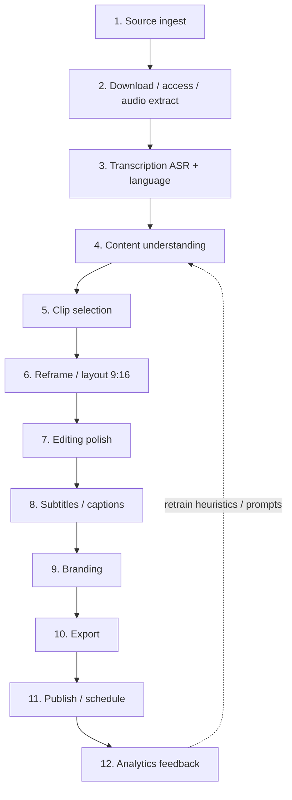

# Video Clipping: Industry & Product R&D Brief

**Workspace:** `/Users/apple/Desktop/Cliping`  
**Research date:** November 2026  
**Scope:** Concept, end-to-end pipeline, platform landscape, AI architecture (high level), quality bar, and build-vs-buy implications for a clipping product.

> **Workspace note:** As of this research, the project folder contains only this `docs/` tree—no application code, notes, or prior R&D artifacts. This document is industry/product research, not a codebase survey.

---

## 1. What “clipping” means (understanding)

**Clipping** is the practice of turning long-form video (YouTube uploads, podcasts, webinars, Twitch/Kick VODs, Zoom recordings, livestreams) into **short, self-contained pieces** optimized for mobile-native feeds: **YouTube Shorts, TikTok, Instagram Reels**, and adjacent formats (LinkedIn video, Facebook Reels, X).

A good clip is not a random trim. It is a **mini-story** that:

- Opens with a **hook** (curiosity, conflict, punchline setup, bold claim)
- Stands alone without requiring the full episode
- Runs typically **15–60 seconds** (sometimes up to ~90s–3 min depending on platform rules and format)
- Is framed for **9:16** (or platform-native ratios)
- Carries **readable captions** for mute autoplay
- Feels **edited on purpose**: clean speech boundaries, stable framing, consistent style

### Why it exists

| Driver | What it means in practice |
| --- | --- |
| **Attention economics** | Feeds reward early retention; shorts are discovery engines for long-form and brands. |
| **Reach asymmetry** | One 90-minute podcast can yield dozens of posts across platforms without filming new content. |
| **Creator economy** | Editors, “clipper” communities, and agencies sell clip production as a service; streamers grow via highlight culture. |
| **Platform incentives** | Shorts/Reels/TikTok algorithms favor frequent posting; clipping is the cheapest content multiplier. |
| **Streamer culture** | Twitch/Kick clips are native highlight currency; reposting to Shorts/TikTok is standard growth ops. |

### Manual vs AI-assisted vs fully automated

| Mode | Who decides the cut | Typical quality | Cost / speed |
| --- | --- | --- | --- |
| **Manual** | Human editor (Premiere, CapCut, DaVinci) | Highest control; best storytelling | Slow, expensive at volume |
| **AI-assisted** | Model proposes clips; human reviews/edits | Best ROI for most creators | Fast draft + human polish |
| **Fully automated** | Model selects, reframes, captions, posts | Uneven; fails on nuance, rights, tone | Cheapest at scale; highest risk of junk |

**Industry consensus (2025–2026):** “One-click viral” marketing oversells. Products that win keep a **human-in-the-loop review** step. Virality scores rank candidates; they do not guarantee views.

### Legal / rights (informative, not legal advice)

Clipping sits at the intersection of **copyright**, **platform policies**, and **monetization rules**:

- **Own content / licensed content:** Safest path. Creators clipping their own YouTube/podcast/stream is the core SaaS use case.
- **Third-party content:** Credit ≠ permission. Fair use (US) is a **case-by-case court analysis** (purpose, nature, amount, market effect)—not a platform toggle. Automated Content ID systems cannot adjudicate fair use.
- **Twitch clips:** Platform clip tools enable sharing; they do **not** transfer ownership. Reposting others’ streams without permission is a rights risk. Streamer settings may allow viewers to share clips to YouTube Shorts—that is a **platform permission path**, not a blanket license for all reuse.
- **Music:** Background music is the most common claim source on stream clips (mutes, claims, strikes)—often more than gameplay itself.
- **YouTube reused-content / Shorts monetization policies:** Compilations and reuploads with little original contribution can be ineligible for monetization even when permission exists.
- **Game publishers:** Many allow gameplay video; some restrict cutscenes, unreleased content, or in-game music—check per-title policies.

**Product implication:** A serious clipping product should assume **rights are the user’s responsibility**, offer clear copy, and preferably support **owned-source workflows** (upload / connected accounts) over scraping arbitrary third-party URLs without authorization.

---

## 2. What “seamless proper clips with subtitles” means in practice

Production-quality clipping is a **bundle of constraints**, not a single feature:

| Dimension | “Proper” | Failure mode |
| --- | --- | --- |
| **In/out points** | Cuts on sentence / breath / joke beat boundaries | Mid-word or mid-thought starts |
| **Narrative** | Self-contained setup → payoff | Requires unseen context |
| **Hook** | Value visible in **first 1–3 seconds** | Slow wind-up; scroll-away |
| **Framing** | Active speaker / subject stays in vertical safe frame | Chopped faces, empty space, letterboxing |
| **Captions** | Accurate, timed, high-contrast, in UI safe zones | Wrong words, tiny text, covered by TikTok UI |
| **Pacing** | Silence/filler trimmed without chopping meaning | Robotic jump-cuts or dead air |
| **Audio** | Clear voice; optional bed music that won’t claim | Clipping copyrighted bed music |
| **Style** | Consistent fonts, brand marks, CTA patterns | Random templates every post |
| **Export** | Platform-ready H.264/AAC, 1080×1920 (or 4K), correct fps | Wrong ratio, soft encode, audio desync |

---

## 3. End-to-end pipeline (every stage)



### Stage 1 — Source ingest

**Inputs:** YouTube URL, Twitch/Kick VOD, Google Drive/Dropbox, local upload (MP4/MOV/WebM), live/near-live stream hooks, Riverside/Zoom recordings.

**Product concerns:** length limits (often 1–3 hours on consumer plans), file size (multi‑GB), auth for private assets, metadata (title, chapters, description) as weak signals for highlights.

### Stage 2 — Download / stream access / audio extraction

**Legitimate product patterns:** user-uploaded files; OAuth-connected platforms; official APIs where available; licensed download helpers for content the user owns/controls.

**Technical norms:** normalize a **proxy** (e.g. 720p H.264) for preview/ML; extract **16 kHz mono WAV** (or similar) for ASR; keep original for final encode.

> Architecture note: Products must respect platform Terms of Service and DRM. This brief describes product architecture, not circumvention methods.

### Stage 3 — Transcription (ASR) & language detection

**Role:** Word-level (or phrase-level) timestamps are the backbone of text editing, caption burn-in, and LLM highlight windows.

**Common stack:** Whisper / WhisperX / cloud ASR (AssemblyAI, Deepgram, Google, OpenAI). WhisperX-style pipelines add **forced alignment** for tighter word times; **pyannote** (or similar) adds **speaker diarization**.

**Language:** Detect primary language; optionally translate captions or dub (many SaaS tools advertise 25–100+ languages with uneven accuracy outside English).

**Quality gates:** proper nouns, jargon, overlapping speech, music-under-voice, non-native accents—always need human caption review for “proper” output.

### Stage 4 — Content understanding

Beyond raw transcript:

| Signal | Use |
| --- | --- |
| **Topic segmentation** | Split episode into chapters / themes |
| **Highlight / virality scoring** | Rank candidate windows (hook, flow, value, trend heuristics) |
| **NLP hooks** | Questions, lists, hot takes, punchlines, “here’s why…” |
| **Prosody / energy** | Loudness spikes, laughter, applause, silence gaps |
| **Visual events** | Scene cuts, on-screen text, action (sports/gaming detectors) |
| **Prompted retrieval** | “Find the part about X” / multimodal search (e.g. Opus ClipAnything, Vizard Spark) |
| **Chapter markers / description** | Cheap prior if creator already labeled moments |

### Stage 5 — Clip selection

**Goals:** Non-overlapping (or lightly overlapping) windows of target duration (often **30–60s**), coherent arcs, hook-first ordering inside the clip (sometimes reorder teasers—advanced).

**UX pattern:** Return a **ranked gallery** with scores + short reasons; user accepts/rejects/trims. Best products expose transcript-linked trim (“delete this sentence → cut video”).

### Stage 6 — Reframing / layout (16:9 → 9:16)

**Techniques:**

- Face detection + tracking (MediaPipe, YuNet/OpenCV, commercial trackers)
- **Active speaker detection (ASD):** audio-visual model picks who is talking when multiple faces exist
- Static median crop for short talking-head clips (stable, intentional look)
- Dynamic pan/zoom for moving subjects
- **Layouts:** single speaker, split-screen dual guests, speaker + screencast, gameplay + facecam

**Hard cases:** screen shares, slides, whiteboard, multi-cam chaos, VTubers, sports wide shots, dark streams.

### Stage 7 — Editing polish

Optional but differentiating:

- Silence / filler-word removal (“um,” “you know”)
- Jump cuts with micro-zooms for energy
- Auto B-roll / emoji / sound effects (taste varies; easy to look spammy)
- Color/audio cleanup (denoise, loudness normalize)
- Hook title cards

### Stage 8 — Subtitles / captions

| Mode | Pros | Cons |
| --- | --- | --- |
| **Burned-in (hardsubs)** | Always visible; platform-proof for mute viewing | Harder to restyle later; encoding cost |
| **Sidecar (SRT/VTT)** | Flexible, accessible, editable | Many short-form apps expect burned style for “native” look |

**Short-form style:** 1–4 words per beat, karaoke/word highlight, bold sans with outline or box, center / lower-center **inside UI safe zones**.

### Stage 9 — Branding

Intro/outro stingers, watermark/logo corner, end CTA (“full episode link”), consistent caption theme, brand kit (fonts/colors). Agencies need multi-brand kits and review links.

### Stage 10 — Export

**Typical targets:**

- **Resolution:** 1080×1920 (standard); 4K vertical on higher tiers
- **Codec:** H.264 + AAC in MP4 (compatibility king); sometimes H.265
- **Length / fps:** match source or 30 fps social default
- **Presets:** TikTok / Reels / Shorts (same master file often reused)
- **Pro handoff:** XML/EDL to Premiere / DaVinci (Opus Clip Pro-class feature)

### Stage 11 — Publishing / scheduling

OAuth to TikTok, YouTube, Instagram, LinkedIn, Facebook; calendar; AI post captions/hashtags; bulk schedule. Instagram publishing is limited to professional accounts.

For **this** codebase, YouTube is the first publish target: official `videos.insert` after an explicit approve step, not an auto-post when export finishes. Decision, quota, Shorts rules, and the job flow: [YOUTUBE_PUBLISH_RND.md](./YOUTUBE_PUBLISH_RND.md). TikTok is the same rule on its own API: [TIKTOK_PUBLISH_RND.md](./TIKTOK_PUBLISH_RND.md). Instagram is possible with no paid API, as a later Facebook Login Reel upload of the local file: [INSTAGRAM_PUBLISH_RND.md](./INSTAGRAM_PUBLISH_RND.md). It is research only. No Instagram phase is open.

### Stage 12 — Analytics feedback loop

Ingest views, watch-time, completion, follows → bias future rankings toward topics/hooks that worked. Few tools close this loop well; most stop at vanity metrics. This is a **major product opportunity**.

---

## 4. Platforms & tools landscape (November 2026)

### Comparison table (high level)

| Tool | Best at | Input → output | Pricing model (public, approx.) | Strengths | Weaknesses |
| --- | --- | --- | --- | --- | --- |
| **Opus Clip** | Category-default AI clipper for podcasts/talking-head | URL/upload → scored vertical clips → editor → post | Credits; Free watermark; Starter ~$15/mo; Pro ~$29/mo (~$14.50/mo annual) | Virality Score; ClipAnything multimodal; reframe; captions; scheduler; XML export on Pro | Minute/credit costs on long shows; score ≠ real virality |
| **Vizard** | Teams / multi-channel repurposing | Link/upload → AI clips + transcript editor → brand templates → schedule | Credits (~1/min); Free 60; Creator ~$29/mo; Business ~$39/mo | Strong editor + publish; API/MCP; multilingual captions | Talking-head biased; reframes struggle on gameplay/screen |
| **Klap** | Budget / volume clipping; pay-per-clip | Link/upload → scored clips → reframe/captions → schedule | Per **generated clip**; Basic ~$29/mo (100 clips) or ~$14.50/mo annual | Clip-metering favors long sources; API + MCP; layouts for split/screencast | Rejected clips still consume allowance; weaker on pure visual moments |
| **Munch Studio** *(formerly GetMunch)* | Agencies / social managers who want clip + calendar | Upload/link → platform-optimized clips → Planner schedule | Social suite with **repurposing minutes**; Essential ~$38/mo annual | Trend/SEO angle; captions + post copy; multi-brand | Pivoted toward full social AI; clipping is one module |
| **Descript** | Transcript-first editorial control | Import → edit like a doc → Create Clips / Underlord | Media hours + AI credits; Hobbyist/Creator tiers ~$12–$35/mo class | Best human control; Studio Sound; full episode + clips | Slower than one-click clip factories |
| **Riverside Magic Clips** | Podcasters already recording in Riverside | Record/upload → Magic Clips → captions/layouts → export | Bundled with Riverside plans (Free watermark; Pro ~$29/mo class) | Zero friction from record → clip | Weaker as standalone clipper |
| **CapCut** | Hands-on short-form finishing | Long video → AI clip/highlight tools → full editor | Free + Pro (regional pricing) | Templates, effects, TikTok-native feel; free entry | More manual; feature availability varies by region/device |
| **Submagic** | Caption polish & retention edits on chosen clips | Upload short/long → Magic Clips / captions / zooms / B-roll | Per-video allowances; ~$12–$41/mo annual tiers | Caption templates, SFX, mobile retention look | Moment picking secondary to polish |
| **Captions (Mirage)** | Mobile-first AI edit, avatars, generative polish | Phone/web → AI Edit / clips / captions | Credit plans; Max ~$24.99/mo class (iOS pricing noted) | Stylish AI edits; eye contact; avatars | Less “podcast batch clipper” than lifestyle/creator edit |
| **VEED** | Browser all-rounder | Upload → subtitles/AI tools/clips → export | Free watermark; Creator ~$20/mo (~$9.67 annual class) | Subtitles + translation + team editor | Not the deepest highlight AI |
| **Clipchamp** | Free Microsoft-adjacent editor | Upload → AI captions/silence/auto compose → export | Free 1080p; 4K via Microsoft 365 | Accessible, bundled AI basics | Not a dedicated long→short clip ranker |
| **Adobe Premiere Pro** | Pro timeline + AI assists | Full NLE; text-based editing; Media Intelligence; Generative Extend | ~$22.99/mo annual class | Maximum quality control | Not automated clipping SaaS |
| **Eklipse** | Gaming stream highlights | Twitch/Kick/YouTube VODs → game-event clips → vertical | Freemium / Premium; game-specific detection | Kills/wins detectors; streamer workflow | Game coverage gaps; captions sometimes extra step |
| **StreamLadder** | Streamer social posting pipeline | Twitch/YT/Kick → ClipGPT → vertical ready-to-post → schedule | Free trial / Creator-Pro; fair-use unlimited claims on higher tiers | Facecam layouts; publisher; analytics angle | Competing in crowded streamer niche |
| **Repurpose.io** | Distribution automation | Connect sources → workflows → multi-format multi-destination | Subscription automation SaaS | Excellent post-clip distribution | Not primarily an AI highlight brain |
| **Twitch native clips** | In-ecosystem highlight sharing | Live/VOD → ≤60s clip → share (incl. Shorts path when enabled) | Free (platform) | Zero friction for community clip culture | Horizontal origin; limited production polish |
| **YouTube Shorts / Create tools** | Native Shorts creation & editing | Camera/upload/edit in Google tooling | Free (platform) | Distribution native | Not a long-form batch repurposer |

**Pivots / naming to note (2026):**

- **GetMunch → Munch Studio:** clipping folded into broader AI social management.
- **quso.ai** formerly associated with Vidyo.ai in some directories (clipping + scheduling competitors).
- Category is crowded; differentiation is **footage type** (podcast vs gaming vs UGC), **metering** (minutes vs clips vs credits), and **publish depth**.

### Open-source / DIY stack

| Component | Common tools | Role |
| --- | --- | --- |
| Acquire / remux | **yt-dlp**, FFmpeg | Source fetch (authorized use) + remux |
| Cut silence | **Auto-Editor**, FFmpeg silencedetect | Rough pacing |
| ASR | **Whisper / WhisperX**, faster-whisper | Transcript + word times |
| Diarization | **pyannote.audio** | Who spoke when |
| Highlights | LLM over transcript (GPT/Claude/Gemini/local) | Candidate windows + titles |
| Faces / ASD | MediaPipe, OpenCV YuNet, LR-ASD / Columbia ASD-class models | Vertical crop target |
| Scenes | PySceneDetect | Cut-aware crop resets |
| Captions | FFmpeg ASS/SRT burn-in; Whisper timestamps | Hardsubs |
| Programmatic motion graphics | **Remotion**, Motion Canvas | Branded templates at scale |
| Orchestration | queues (Inngest, Celery), GPU hosts (Modal, RunPod) | Job pipeline |

DIY can match SaaS quality for **talking-head podcasts** with engineering investment; gaming event detection, durable social APIs, and polished mobile UX are where SaaS still wins time-to-market.

---

## 5. How AI clippers work under the hood (architecture)

```text
┌─────────────────────────────────────────────────────────────┐
│                     Control plane (API / UI)                │
│  job create → progress WS/poll → review gallery → export    │
└───────────────────────────┬─────────────────────────────────┘
                            │
┌───────────────────────────▼─────────────────────────────────┐
│                     Worker / GPU pipeline                   │
│  ingest → proxy+wav → ASR+align → diarize → understand      │
│  → rank windows → ASD/faces → crop schedule → edit ops      │
│  → caption render → brand composite → encode → store        │
└─────────────────────────────────────────────────────────────┘
```

### Model classes

1. **ASR + alignment:** speech → words with `start`/`end`.
2. **NLP / LLM highlight rankers:** score segments for hook density, completeness, novelty; emit JSON windows (e.g. 30–90s, non-overlapping).
3. **Multimodal video understanding:** frame/audio/sentiment features for low-dialogue content (sports, vlogs)—the direction products like ClipAnything advertise.
4. **Face / object trackers + ASD:** choose crop center over time.
5. **Optional generative layers:** B-roll, emoji, music beds, translated dubs—higher taste risk.

### Heuristics that still matter

Even with LLMs, production systems blend rules:

- Prefer starting at sentence starts / after pauses  
- Avoid ending mid-clause  
- Boost question→answer pairs, lists, controversies, laughter  
- Prefer chapter boundaries and description keywords  
- Penalize pure silence, ads, “subscribe” rambling (unless that’s the brand bit)  
- Energy / loudness peaks as tie-breakers  
- For gaming: kill feed, victory screens, chat spike proxies (product-specific)

### Human-in-the-loop UX (hallmark of good products)

- Ranked candidates with **why this clip** text  
- Transcript-linked trimming  
- Manual reframe override / layout picker  
- Caption spelling QA  
- Brand kit apply-all  
- Approve → schedule, not auto-post-everything by default

### Honest limitations of AI clipping

- **Context blindness:** model misses callbacks, irony, spoilers, private jokes  
- **False virality:** high scores on generic hot takes that flop  
- **Visual content:** tutorials, code screens, slides need different crop logic than faces  
- **Caption errors** destroy trust faster than a slightly late cut  
- **Rights / music** cannot be “AI’d away”  
- **Homogeneous style:** emoji-spam captions fatigue audiences  
- **Analytics loop** rarely trains personal taste models well yet  

---

## 6. Quality bar & best practices

### Good clip vs bad auto-cut

| Good | Bad |
| --- | --- |
| Hook in first 1–3s (“The real reason X failed…”) | 8s of “so uh yeah welcome back” |
| Complete thought with payoff | Ends right before the punchline |
| Speaker eyes/face framed with headroom | Forehead cut off; chin-only crop jitter |
| Captions match audio; names spelled right | Hallucinated words, especially brands |
| 20–45s tight for most hooks | 90s of meandering with no structure |
| Pattern interrupt (zoom, cut, title) with purpose | Random jump-cuts every 0.4s |

### Subtitle design for Shorts / Reels / TikTok

- **Heavy sans-serif**, large, high contrast (white + black outline or box)  
- **1–4 words** on screen for short-form kinetic captions; highlight active word  
- Place in **center / lower-center**, clear of:
  - Bottom username / caption / music bar  
  - Right-side like/comment/share rail  
  - Top status / sponsored labels  
- Conservative shared safe zone on 1080×1920: keep critical text away from roughly **top ~240px, bottom ~420px, right ~200px** (platforms differ; verify on-device)  
- Minimum readable dwell (~2s for short phrases; don’t flash paragraphs)

### Aspect ratio & masters

- Master vertical at **1080×1920**; optionally export 1:1 or 4:5 for feed experiments  
- Avoid black letterboxing—reads as low effort  
- For dual speakers, prefer **split layouts** over rapid face-ping-pong unless intentional  

### Hook craft

- On-screen hook text at **frame 0–0.5s**  
- Start on the most curiosity-dense sentence, then optionally jump back for context (advanced editorial)  
- Pattern: **claim → proof → punchline/CTA**

---

## 7. Build vs buy (implications for a product named “Cliping”)

### Who to serve first (recommended focus)

Highest product-market fit for new entrants remains:

1. **Podcasters / interview shows** (speech-heavy, two-shot, weekly volume)  
2. **Course/webinar marketers** (permissioned B2B content)  
3. **Streamers** only if investing in gaming-specific detectors (harder ML moat already contested by Eklipse/StreamLadder)

### MVP stages

| Stage | Ship | Success metric |
| --- | --- | --- |
| **MVP-0** | Upload → Whisper transcript → manual text select → FFmpeg vertical center crop → burned captions | Time-to-first-clip < 10 min |
| **MVP-1** | LLM-ranked clip candidates + review UI + face-centered crop | ≥30% of suggestions accepted with light trim |
| **MVP-2** | ASD for multi-speaker, brand kits, SRT download, 1080p export presets | Weekly active publishers |
| **MVP-3** | Social schedule + basic analytics feedback | Posts per user / week |
| **MVP-4** | Prompted clip search, layouts (split/screen), API | Team/agency retention |

### Hard problems (where products burn time)

1. **Active speaker + stable crop** on imperfect video  
2. **Boundary quality** (never start mid-word)  
3. **Caption accuracy** on names/jargon  
4. **GPU cost** vs pricing (Whisper large + ASD + encode on hour-long VODs)  
5. **Social API fragility** (Instagram especially)  
6. **Trust & rights** UX  
7. **Taste:** avoiding generic “AI clipper” aesthetic  

### Buy (API/SaaS) vs build (custom ML)

| Layer | Prefer buy / API | Prefer custom |
| --- | --- | --- |
| ASR | Deepgram / AssemblyAI / OpenAI until cost forces self-host Whisper | Self-host WhisperX at scale |
| LLM ranking | Hosted LLM with strict JSON schemas | Fine-tuned ranker once you have accept/reject data |
| Faces | MediaPipe / cloud vision | Custom ASD if multi-guest is core |
| Captions rendering | Remotion / FFmpeg ASS templates | Proprietary motion styles as brand moat |
| Publishing | Late; use native exports first | Build scheduler only after clip quality is loved |
| Gaming event AI | Don’t start here | Only with labeled game-specific data |

### Differentiation opportunities (white space)

- **Closed analytics loop** that actually improves *this channel’s* clip taste  
- **Editorial standards engine** (hook templates per niche: comedy vs B2B vs fitness)  
- **Agency workflow:** review links, versioning, client brand kits (Munch-like) without forcing full social suite  
- **Pro handoff:** pristine XML + unburned captions for Premiere teams  
- **Quality over quantity:** fewer clips, higher acceptance rate (opposite of spammy 40-clips-per-episode defaults)

---

## 8. Reference architecture for a Cliping MVP (conceptual)

```text
[Web app]
   |  createJob(source)
   v
[API + Postgres + object storage]
   |
   +--> [Queue workers]
          1) ingest/validate
          2) ffmpeg proxy + wav
          3) ASR (word times)
          4) LLM highlight JSON
          5) face/ASD crop path
          6) caption + encode
          7) notify ready_for_review
   |
   v
[Review UI] accept/trim/reframe/fix captions → export MP4
```

**Non-goals for v1:** fully automatic posting, DRM YouTube ripping as a feature, gaming event nets, generative avatar hosts.

---

## 9. Open questions for a future product build

1. **ICP:** Podcast editors, agencies, or streamers first?  
2. **Metering:** credits (minutes in), clips out, or seats?  
3. **Source strategy:** upload-only vs connected OAuth vs URL import (ToS/compliance review required)?  
4. **Caption identity:** distinctive house style vs CapCut-like template mall?  
5. **Model budget:** cloud APIs vs owned GPUs at what monthly minutes?  
6. **Human review:** required gate vs optional autopilot?  
7. **Moat:** workflow/UX, niche models, or distribution integrations?  
8. **Compliance:** how to educate users on rights without blocking legitimate clipper businesses?

---

## 10. Sources & further reading (sampled November 2026)

Vendor/docs and market writeups consulted for feature/pricing snapshots (verify before purchasing; prices change often):

- Opus Clip — product, ClipAnything, Virality Score, pricing (`opus.pro`)  
- Vizard — product & pricing (`vizard.ai`)  
- Klap — pricing / llms.txt feature summary (`klap.app`)  
- Munch Studio — features & pricing (`munchstudio.com`; formerly GetMunch)  
- Riverside Magic Clips, Descript Create Clips, CapCut AI clip/caption surfaces  
- Eklipse / StreamLadder — streamer clipping positioning  
- YouTube Help — Fair use overview  
- Twitch Help — Clips & sharing (including Shorts path)  
- Engineering writeups on WhisperX + LLM windows + ASD vertical pipelines (e.g. open DIY clipper architectures on GitHub / practitioner blogs)  
- Short-form caption/safe-zone guides (creator tooling blogs, 2025–2026)

---

## 11. One-page summary

**Clipping** = long-form → short-form discovery content with vertical framing and captions.  
**Pipeline** = ingest → ASR → understand/rank → cut → reframe → polish → caption → brand → export → (optional) publish → learn.  
**Market** = crowded SaaS (Opus, Vizard, Klap, et al.) plus editors (CapCut, Descript, Premiere) and streamer specialists (Eklipse, StreamLadder).  
**Quality** = hook-first, speech-clean boundaries, stable speaker framing, safe-zone captions—not raw model dumps.  
**Build** = start with speech-heavy owned content, human review, and ruthless crop/caption quality; buy ASR/LLM early; customize ASD, templates, and feedback loops later.

*End of R&D brief.*
