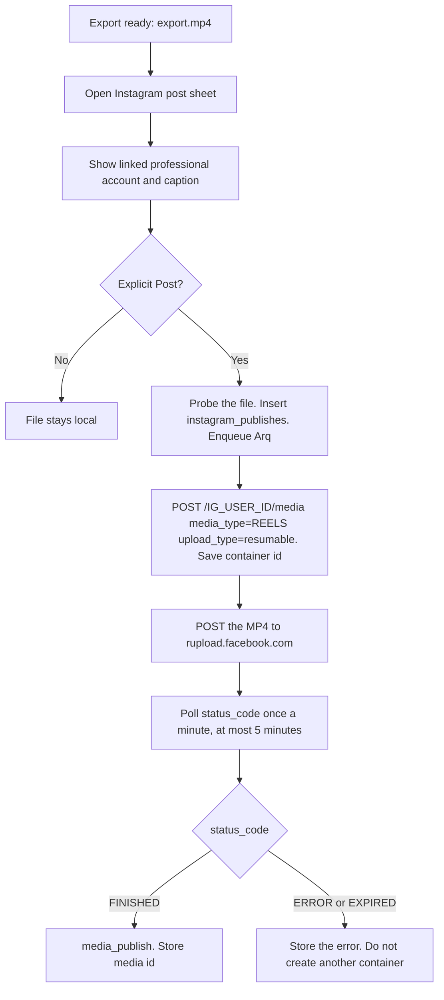

# Instagram publish — R&D

**Workspace:** `/Users/apple/Desktop/Cliping`  
**Research date:** 17 November 2026  
**Decision this unblocks:** After a clip is exported, can Cliping post that file to the operator’s own Instagram account the way Phase 6 posts to YouTube and Phase 7 posts to TikTok, and does that path need a paid service?  
**Status:** Research only. No Instagram code, no phase, and no new dependency. YouTube and TikTok stay separate flows: [YOUTUBE_PUBLISH_RND.md](./YOUTUBE_PUBLISH_RND.md), [TIKTOK_PUBLISH_RND.md](./TIKTOK_PUBLISH_RND.md).

---

## Verdict

**Yes.** The supported path is Meta’s **Instagram API with Facebook Login**, posting a **Reel** from the file we already encode.

The worker creates a container with `POST /{ig-user-id}/media` (`media_type=REELS`, `upload_type=resumable`), `POST`s `export.mp4` to `rupload.facebook.com`, waits until `status_code` is `FINISHED`, then calls `POST /{ig-user-id}/media_publish`. That resumable upload is how a local file gets to Instagram. Meta’s other login, **Instagram Login** (`graph.instagram.com`), can publish too, but only from a `video_url` on a public server that Meta downloads. That fights local-first. Do not use it, and do not add a host just to satisfy it.

**No paid dependency.** The pages fetched on this date list requirements and rate limits. They do not list a price, a credit pack, or a required paid SDK. A professional account, a Facebook Page, and a Meta developer app are free to create. For an app that only posts to an account the operator owns, **Standard Access** is enough and **App Review is not required**. `httpx`, already in `services/api`, can make the calls. Third-party posters (Ayrshare and similar) are subscriptions on top of this same API. Do not add one.

This is not a personal-account feature. Instagram’s platform only publishes for a **professional** account (Business or Creator). The Facebook Login path also needs that account **linked to a Facebook Page**, and the operator must be allowed to create content on that Page. A personal Instagram login cannot call this API.

The product rule stays **approve, then upload**. Finishing an export must not post. The operator sees the Instagram account, edits the caption, and clicks Post. There is no private/unlisted switch and no native schedule. `media_publish` publishes now. The account’s own privacy and remix settings still apply.

---

## Options compared

| Option | Fit for Cliping | Cost | Local? | Risk |
| --- | --- | --- | --- | --- |
| **Facebook Login + resumable Reel upload** of `export.mp4` | Official. Posts the file we already encode. Matches the worker we already have for YouTube and TikTok. | $0 API fee. A Meta app in Development mode. **100 API-published posts per account per 24 hours** on the rate-limit section (see the 50-post contradiction below). | Pipeline stays on disk. The upload is the only required network step. | Needs a professional account and a linked Page. No native private or schedule. A second container is a second post. |
| **Instagram Login + `video_url`** | Official publish, no Facebook Page. | $0 | No. Meta fetches a public HTTPS file. | Fights local-first. Do not use. |
| **Download the MP4 and post in the Instagram app** | Already possible. Keep it as the fallback. | $0 | Yes | No automation. |
| **Third-party poster** (Ayrshare and similar) | Same underlying API. The vendor holds the token. | Subscription | No | Extra terms and an extra outage. Fights local-first. |
| **Drive the Instagram website or app** | Looks like automation. | $0 | Local | Fragile, unsupported, account risk. Do not build. |
| **Session cookies or private upload endpoints** | Not a product path. | — | — | Account loss. Do not build. |

---

## Recommendation

Do not start an Instagram phase in the same run as YouTube or TikTok work. When it is built, keep it in `app/instagram/`, its own table, and its own button. Leave `app/youtube/` and `app/tiktok/` alone. Feature off when the Meta app id is empty.

**Ship in that future phase**

1. **Connect Instagram** once, with Facebook Login for Business, while the Meta app stays in **Development mode**. That is the mode where Meta still allows an `http://localhost` redirect.
2. A bar on the gallery, separate from YouTube and TikTok: account name, caption, one **Post N clips** button.
3. An Arq job that uploads `export.mp4` unchanged and stores the container id before any byte is sent.
4. Status on the card: uploading → processing → posted / failed, plus the media id when publish returns one.

**Leave out of that phase**

- Posting when export finishes, with no click.
- Instagram Login, a public file host, or a third-party poster.
- Stories, carousels, photos, product tags, collaborators, comments, insights, messaging, webhooks.
- A native schedule. The API has no `publishAt`. A container dies after **24 hours** if it is not published. Holding the job locally and calling `media_publish` later only works while the computer stays on and the container is still inside that window.
- App Review and Business Verification. Those exist for an app that posts to accounts the operator does not own. This box does not need them.
- Re-encoding inside the publish job. If a probe check fails, fail the post with a clear message.

**Library:** `httpx`. There is no Meta package to add.

---

## Paid or not

| Item | Pay? |
| --- | --- |
| Instagram content publishing calls | No fee on the official docs |
| Meta developer app | Free |
| Switching the Instagram account to Professional (Business or Creator) | Free, in the Instagram app |
| Facebook Page, and linking it to that account | Free |
| Standard Access for an account you own | Free. App Review is not required |
| App Review and Business Verification | Not required for this one-operator app. This research found no published fee; they are review steps for posting to other people’s accounts |
| Python package | None. Use `httpx` |
| Ayrshare and other “Instagram API” vendors | Paid. Do not use |

---

## Required flow

What the operator does once, in Meta’s tools, before any of that:

1. In the Instagram app, switch the account to **Professional** (Business or Creator). Personal accounts cannot publish through this API.
2. Create a **Facebook Page** and connect it to that Instagram account. The Facebook Login publish path requires the Page. The login window can offer this setup in one step (`extras={"setup":{"channel":"IG_API_ONBOARDING"}}`).
3. Create an app at [developers.facebook.com](https://developers.facebook.com/). Add **Facebook Login for Business** and **Instagram → API setup with Facebook login**. Leave the app in **Development mode**. Add the operator as a role on the app.
4. Request `instagram_basic`, `instagram_content_publish`, `pages_show_list`, and `pages_read_engagement`. The publishing reference and the login sample use `instagram_content_publish`. The App Review page spells a related name `instagram_content_publishing`. Use the name on the permission toggle in the dashboard, then confirm with one successful call.
5. The operator must be able to perform the **Content** task on the Page (`CREATE_CONTENT` / `PROFILE_PLUS_CREATE_CONTENT`). That task is what allows `instagram_content_publish`.
6. Put the app id and app secret in env, not in git.
7. Register the redirect the browser actually uses: `http://localhost:3001/api/backend/api/v1/instagram/callback`. Meta’s 2018 HTTPS post still allows HTTP for `localhost` **only while the app is in development mode**. The current login sample shows an `https://` redirect and does not mention port 3001. Confirm the dashboard accepts the localhost URI on the first Connect click. If it rejects it, fix the redirect. Do not stand up a public file server.
8. Click **Connect**. After redirect, call `GET /me/accounts?fields=id,name,access_token,instagram_business_account` and store the Page id, the Page token, the user token, and `instagram_business_account.id`. If more than one Page comes back, the operator picks the Page whose Instagram account should receive the posts.

An app can use Facebook Login or Instagram Login, not both.

---

## How the calls work

Samples on the pages fetched this date use Graph API **v27.0**. Put the version in settings. Do not scatter it.

1. `POST https://graph.facebook.com/v27.0/{ig-user-id}/media` with `media_type=REELS`, `upload_type=resumable`, and the caption. Success returns `id` (the container) and `uri` (`https://rupload.facebook.com/ig-api-upload/v27.0/{container-id}`). Persist both before reading the file.
2. `POST` that `uri` with `Authorization: OAuth {token}`, header `offset: 0`, header `file_size` set to the byte length, and the MP4 as the body. Success is `{ "success": true, "message": "Upload successful." }`. The status payload shows `uploading_phase.bytes_transferred`. A later attempt can send `offset` at that byte count. A new container is a new post, so a crash must resume this container, not create another one.
3. `GET /{container-id}?fields=id,status,status_code,video_status`. Meta’s own guidance is once a minute, for no more than 5 minutes, until `status_code` is `FINISHED`. Values: `IN_PROGRESS`, `FINISHED`, `PUBLISHED`, `ERROR`, `EXPIRED`.
4. `POST /{ig-user-id}/media_publish` with `creation_id` set to the container id. Success returns the published media id.

`upload_type=resumable` is documented only for apps that implemented **Facebook Login for Business**. Hosts are `graph.facebook.com` for the container and publish, and `rupload.facebook.com` for the bytes.

### Which token

Official pages disagree, so the first live call has to settle it. Store both tokens and do not fire a second publish to “try the other one.”

- The [login guide’s closing list](https://developers.facebook.com/docs/instagram-platform/instagram-api-with-facebook-login/business-login-for-instagram) says the **user** access token is what the Instagram Graph API requires, and the **Page** access token is what the Messaging API requires.
- The [content publishing requirements table](https://developers.facebook.com/docs/instagram-platform/content-publishing/) says the Facebook Login column uses a **Facebook Page** access token.

The login redirect can return a short-lived user token (`expires_in` was `4815` seconds in Meta’s sample, about 80 minutes) and a `long_lived_token`. The platform overview says the long-lived token lasts **60 days** and can be refreshed. It also returns `data_access_expiration_time`. When that access expires, the operator connects again. A long-lived Page token, requested with a long-lived user token via `GET /{user-id}/accounts`, is documented as having **no expiration date**; it still dies if the person loses their role on the Page or removes the app.

The login guide’s sample uses `response_type=token`, which puts the token in the URL fragment. The platform overview describes an authorization **code** that the server exchanges. Use the code exchange on the API, with the app secret, the same shape as YouTube and TikTok. Do not copy the fragment sample into the browser.

### Caption and switches

From the [IG User Media](https://developers.facebook.com/docs/instagram-platform/instagram-graph-api/reference/ig-user/media) reference:

- `caption`: **2200 characters**, **30 hashtags**, **20 @ tags**. Hashtags and @names count toward the caption. An @mention notifies that account when the container is published.
- `share_to_feed`: `true` means the Reel may also show in the feed. `false` means Reels tab only. Neither value forces the Reels tab to show it. This field is on the `video_url` example. It is **absent** from the resumable upload’s optional-parameter list. Do not send it until one live resumable call accepts it.
- `is_ai_generated`: optional self-disclosure. Leave it off unless the operator turns it on. Burned captions are not a reason to set it.
- `thumb_offset`: a frame offset for the cover. `cover_url` is a public image URL, so skip it on the local path.
- `trial_params.graduation_strategy`: `MANUAL` (the operator graduates it in the Instagram app) or `SS_PERFORMANCE` (Instagram may graduate it automatically). A trial Reel is shared to **non-followers**, not saved as a private archive. The field is documented on the `video_url` example and is **absent** from the resumable optional-parameter list. Same rule: confirm on one live call before showing the switch. Do not default to `SS_PERFORMANCE`.

There is no privacy enum. A public professional account gets a public Reel. Remix and other account settings are kept as the account already has them.

---

## Reel file rules, against our export

Source: Reel specifications on the IG User Media reference, fetched 17 November 2026. Our encoder is `services/api/app/pipeline/export.py`. Autopilot bounds are `clip_min_sec=5` and `clip_max_sec=180` in `services/api/app/config.py`.

| Rule | Cliping today | Before upload |
| --- | --- | --- |
| MP4, moov atom at the front, no edit lists | `-movflags +faststart` | Fits the moov rule. Edit lists are not set; the first live post confirms them. |
| H.264, progressive, 4:2:0, closed GOP | `libx264`, `-pix_fmt yuv420p` | Codec and chroma fit. Closed GOP is not an explicit flag. Do not re-encode to add one unless a real post fails for that reason. |
| AAC, 48 kHz maximum, 1 or 2 channels, “128kbps” | `-c:a aac -b:a 128k` when the source has audio | Bitrate matches the documented figure. The page says **maximum** for sample rate and for the 25 Mbps video bitrate. It does not say maximum for the 128 kbps audio figure. Sample rate is not set, so it follows the source. Reject above 48 kHz. |
| No audio track | `-an` when the source has no audio | The spec describes an AAC track. Treat a silent export as a failed preflight, not as a guess. |
| 23–60 fps | Not set. The source frame rate is kept. | Reject outside 23–60. 24, 25, 30, and 60 pass. |
| Width at most 1920; 9:16 recommended | 1080×1920 | Fits. |
| 3 seconds to 15 minutes | Autopilot clips are 5–180 seconds | Fits those clips. A hand trim outside 3 seconds–15 minutes fails the preflight. |
| 300 MB maximum | No size cap on the export | Reject a larger file. |
| Video bitrate at most 25 Mbps | libx264 default CRF, no `-b:v` | Probe it. A short 1080×1920 clip is unlikely to hit 25 Mbps; the check is still cheap. |

Containers: **400 per account per rolling 24 hours**, and each one **expires after 24 hours**. A container that errors still counts. Do not loop.

---

## Limits and access

- **Who can post.** Professional account only. Facebook Login also needs the linked Page and the Content task. If that Page later requires Page Publishing Authorization, or two-factor authentication, publish fails until the operator completes it. Meta says you cannot tell in advance whether a Page will start requiring that authorization.
- **Standard Access.** Default. Enough when the app only serves an Instagram professional account the operator owns or manages, and that person has a role on the app. The App Review table says this scenario does **not** require App Review, for either “No login or Facebook Login” or Instagram Login.
- **Advanced Access.** Required only if the app posts for accounts the operator does not own, or for people with no role on the app. That needs App Review and Business Verification. Out of scope.
- **Posts.** The rate-limit section says **100 API-published posts per Instagram account in a moving 24-hour window**, enforced on `media_publish`. A carousel counts as one post. The carousel limitations paragraph on the same page still says **50 published posts** in 24 hours. Those two sentences disagree. Call `GET /{ig-user-id}/content_publishing_limit` when the operator opens the sheet, and stop when the live value says the account is at the cap.
- **Development mode.** Roles on the app can grant the permissions. `http://localhost` HTTP redirects are allowed in that mode. Switching the app to Live turns that off and would also be the wrong move for a one-operator tool that has not gone through App Review.
- **Quota is the account’s, shared with other API clients**, the same way TikTok’s daily cap is. The docs describe the limit on the Instagram account, not a per-app bucket.

---

## How this differs from YouTube and TikTok

| | YouTube | TikTok | Instagram |
| --- | --- | --- | --- |
| Call | Resumable `videos.insert` | `video/init` + `PUT` + `status/fetch` | Container + `rupload` + `media_publish` |
| Identity | Google account, channel | TikTok account | Professional Instagram account **and** a Facebook Page |
| Local file | Yes | Yes | Yes, Facebook Login only. Instagram Login needs a public URL. |
| Schedule | `publishAt` | None | None. Container lasts 24 hours. |
| Private first post | `private` | `SELF_ONLY` on a private account, until audit | No private value. Trial Reels reach non-followers, and only if the resumable call accepts `trial_params`. |
| Review before public posts | Not required for your own channel | TikTok audit before anything wider than Only me | Not required for your own account (Standard Access) |
| Caption | Title and description | One field, 2200 UTF-16 units | One field, 2200 characters, 30 hashtags, 20 @ tags |
| Daily cap | 100 `videos.insert` | About 15 direct posts per account | 100 on the rate-limit section; a 50-post sentence still sits on the same page |
| Paid | No | No | No |

---

## What not to do

- Do not post from a personal Instagram account, or by driving the website.
- Do not add a CDN, ngrok file host, or a paid poster so Instagram Login can curl the MP4.
- Do not turn the Meta app Live, or submit App Review, for this one-operator box.
- Do not create a second container because the first upload timed out.
- Do not treat a trial Reel as a private save, and do not set `SS_PERFORMANCE` unless the operator chose it.
- Do not re-encode `export.mp4` inside the publish job.

---

## Sources

Fetched 17 November 2026.

- [Content Publishing](https://developers.facebook.com/docs/instagram-platform/content-publishing/) — both logins, resumable local file, 100-post rate limit, 50-post carousel sentence, container status values, trial Reels, `is_ai_generated`.
- [Upload Video to Meta Servers](https://developers.facebook.com/docs/instagram-platform/content-publishing/resumable-uploads) — resumable is Facebook Login for Business only; `rupload.facebook.com`; offset resume.
- [IG User Media](https://developers.facebook.com/docs/instagram-platform/instagram-graph-api/reference/ig-user/media) — Reel spec (codec, fps, 1080-class 9:16, 3 seconds–15 minutes, 300 MB), caption limits, 400 containers / 24 hours, 24-hour expiry. Examples use v27.0.
- [Instagram Platform overview](https://developers.facebook.com/docs/instagram-platform/overview) — professional accounts only; Standard vs Advanced Access; Page required for Facebook Login; long-lived token 60 days; authorization code then token. Page updated 30 June 2026.
- [App Review for Instagram API](https://developers.facebook.com/docs/instagram-platform/app-review) — own-business app, Standard Access, App Review not required. An app uses one login type.
- [Facebook Login for Business — Instagram API](https://developers.facebook.com/docs/instagram-platform/instagram-api-with-facebook-login/business-login-for-instagram) — onboarding extras, scopes, `GET /me/accounts`, user token for Graph API vs Page token for messaging.
- [Long-lived access tokens](https://developers.facebook.com/docs/facebook-login/guides/access-tokens/get-long-lived) — long-lived Page token has no expiration date.
- [Requiring HTTPS for Facebook Login](https://developers.facebook.com/blog/post/2018/06/08/enforce-https-facebook-login/) — HTTP `localhost` remains available in development mode.
- This repo: `services/api/app/pipeline/export.py`, `services/api/app/config.py`.
