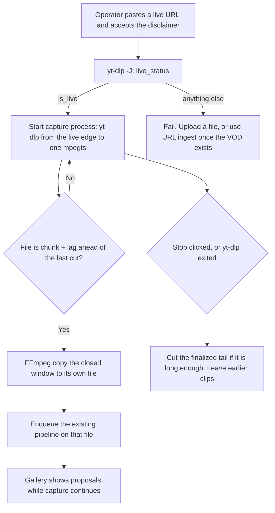

# Livestream clips — R&D

**Workspace:** `/Users/apple/Desktop/Cliping`  
**Research date:** 16 November 2026  
**Decision this unblocks:** Can Cliping make short clips from a YouTube livestream that is still on air, and what has to change?  
**Status:** Research. The playbook is [plans/PHASE_8_LIVESTREAM_CLIPS.md](./plans/PHASE_8_LIVESTREAM_CLIPS.md). TikTok publish stays out of this work.

Listing public streams that are on air now is a different question. There is no API for every livestream on YouTube. See [YOUTUBE_LIVE_DISCOVERY_RND.md](./YOUTUBE_LIVE_DISCOVERY_RND.md). This file is about recording one broadcast the operator already chose.

Using live chat to skip quiet minutes, instead of transcribing every 5-minute window, is also a different question. See [LIVE_CHAT_SPIKE_RND.md](./LIVE_CHAT_SPIKE_RND.md). That work is research only. It does not change upload or finished-URL ingest.

---

## Verdict

The app today cannot clip a livestream that is still in progress. URL ingest is a one-shot download of a finished file. It starts `yt-dlp`, waits until that process exits, and only then probes a duration and runs Whisper. A broadcast that is still live does not produce that file. The download either fails the duration filter, or it follows the broadcast until the stream ends or the one-hour subprocess kill deletes the partial.

Clipping while the stream continues is a different ingest. Record continuously, cut only closed time ranges, and run the existing normalize → ASR → propose → export path on each range. The first clips show up about one chunk behind the live edge (default 5 minutes, plus Whisper), not at the moment the words are spoken. The supported capture tool is `yt-dlp`’s native live downloader plus FFmpeg. `--download-sections` is the wrong tool on an active broadcast. The YouTube Data API and the Live Streaming API do not return the media file.

When the operator is the broadcaster, the cleaner source is a local recording (OBS split files, or the same signal already being sent to YouTube). Pulling the public YouTube URL is the convenience path, under the same rights disclaimer as URL ingest.

A stream that has already ended, and that YouTube has turned into a normal video, can use the existing URL ingest if it is within the 3 hour and 8 GB caps. That path is “download the VOD.” It is not this feature.

---

## What the code does today

| Piece | Behavior | Why a live URL stops here |
| --- | --- | --- |
| `source_type` | `upload` or `url` only | There is no live project. |
| `yt_dlp_argv` | `--match-filter duration <= MAX_SOURCE_DURATION_SEC` (default 10800), merge to mp4, no `--live-from-start` | The filter compares a finite `duration`. A live item often has none. There is no live flag. |
| `download_url` | Blocks on the `yt-dlp` process. Timeout **3600 s**. On timeout or non-zero exit, partials in `raw/` are deleted. | A follow-until-the-stream-ends recording is killed at one hour and thrown away. |
| `run_ingest` | Requires `duration > 0` and `duration <= max` before any later stage. | ASR never starts on an open-ended file. |
| Worker | Arq `max_jobs=1`. One pipeline job owns the worker until it returns. | A multi-hour follow would block every other export. |
| Project page | Loads the gallery only when status is `ready_for_review`, `done`, or `exporting`. | A project that stays `processing` never shows clips that arrived mid-stream. |

So pasting a `/live` or `watch?v=` URL of a broadcast that is still on air does not produce proposals. The honest operator message today is: wait until YouTube finishes the VOD, or upload a file you have rights to.

---

## Options compared

| Option | Fit for Cliping | Cost | Local? | Risk |
| --- | --- | --- | --- | --- |
| **Continuous yt-dlp recording, FFmpeg cuts closed windows, existing pipeline per window** | Matches the stack. Clips appear during the broadcast. Recorder stays off the `max_jobs=1` slot. | $0. Disk for the growing capture plus each kept chunk. | Yes. Network only to fetch the stream the operator already pointed at. | YouTube extractor breakage. Same ToS/copyright caveat as URL ingest. A growing file must not be transcribed at the live edge. |
| **Local segments from the operator’s own broadcast** (OBS “split by time”, or a local copy of the signal they already send) | Best rights story. No extractor. Same chunk pipeline. | $0 | Yes | The operator has to point Cliping at a folder of finished files. |
| **Wait for the VOD, then today’s URL ingest** | Already built. | $0 | Yes | Clips exist only after the stream ends and YouTube finishes processing. Useless while the broadcast is still on. 3 h / 8 GB caps still apply. |
| **`--download-sections` on the live URL** | Looks like “grab minute 10–15.” | $0 | Yes | A yt-dlp maintainer stated in May 2025 that `--download-sections` cannot be used on an **active** livestream ([yt-dlp#13175](https://github.com/yt-dlp/yt-dlp/issues/13175)). Section download also goes through FFmpeg and is much slower than the native downloader. Do not build the phase on this. |
| **`--live-from-start` as the whole design** | Documented, experimental, YouTube/Twitch/TVer/mellow-fan only. Records from the earliest available point and **keeps going until the broadcast ends**. | $0 | Yes | It does not stop at “now.” It is a backlog switch for the spike, not a chunker. YouTube DVR rewind is limited; Google says DVR may be limited or unavailable past **12 hours**. |
| **YouTube Live Streaming API / Data API as the media source** | `liveBroadcasts` can describe a broadcast you own (`enableDvr`, `enableArchive`, life-cycle status). | $0 API | Metadata call only | There is still no sanctioned “give me the bytes” endpoint. Do not invent a download scope. |
| **Cookies, membership bypass, or a private live** | Not a product path. | — | — | Account risk, and it fights the ingest policy. Fail clean and tell the operator to upload a file they have rights to. |

---

## Recommendation

Build this as its own phase, behind `ALLOW_LIVE_INGEST=false` by default. Keep `ALLOW_URL_INGEST` as the gate it already is. Do not fold the follow loop into `download_url`.

**Ship in that phase**

1. A live project, separate from `url`. Probe with `yt-dlp -J` (no download). Continue only when `live_status` is `is_live`. Upcoming, members-only, and login-walled URLs fail with the existing “upload a file you have rights to” message.
2. A capture process that is not the pipeline worker. It runs `yt-dlp` from the current live edge (the default `--no-live-from-start`). On yt-dlp 2026.10.26 the growing file is `follow.mp4.part` and the container inside it is mpegts. Probe and cut that partial. Do not wait for the final `.mp4` rename. See the spike in [plans/PHASE_8_LIVESTREAM_CLIPS.md](./plans/PHASE_8_LIVESTREAM_CLIPS.md).
3. A cutter that waits until the file is at least `LIVE_CHUNK_SEC + LIVE_EDGE_LAG_SEC` long (defaults 300 + 20), then FFmpeg-copies that closed window to its own file. The last 20 seconds stay untouched until more media arrives. Overlap the next window by `LIVE_CHUNK_OVERLAP_SEC` (default 20) so a sentence on the boundary can be snapped, then drop duplicate proposals.
4. One normal pipeline job per closed window: normalize, ASR, proposals. Clip times stay local to that file. Store the stream offset so the gallery can say where the moment was in the broadcast.
5. A Stop control. On stop, or when `yt-dlp` exits because the broadcast ended, ingest the finalized tail if it is at least `CLIP_MIN_SEC`. Leave already-made clips in place.
6. The project page shows clips while the capture is still running.

**Leave out of that phase**

- TikTok, and any change to publish.
- Posting a clip because a chunk finished. Review and the explicit Post click stay as they are.
- `--download-sections` against an active broadcast.
- Cookies, PO tokens, or membership bypass.
- Catch-up of the whole DVR by default. Optional `--live-from-start` only if the spike proves a bounded backlog, and never past the existing 3 hour source cap in one project.
- A second YouTube OAuth scope just to list “your live.” The operator pastes the URL.
- Twitch, Kick, or a generic RTMP server. A local folder of finished segments is in scope because it avoids the extractor. A new ingest protocol is not.
- Clipping the live edge itself. Whisper needs a closed file.

**Latency.** With a 5 minute chunk, a 20 second lag, and Whisper on CPU, the first proposals land on the order of 7–12 minutes after the moment happened. A GPU shortens the Whisper part. Shortening the chunk below about 3 minutes makes worse clips (the ranker wants 20–60 seconds and a sentence boundary) and spends more time starting Whisper.

**Worker shape.** Capture is long-lived and mostly waiting on the network. The pipeline worker stays `max_jobs=1` and only sees closed files. If capture ran as the pipeline job, a 4 hour stream would block every export on the box. Run capture as its own process supervised by the API (one live project at a time).

**When the broadcast is yours.** Prefer a directory of files OBS (or an equivalent recorder) has finished splitting. Each finished file is a chunk. Skip `yt-dlp` entirely. Use the YouTube URL only when that local recording does not exist.

**After the stream.** If the operator instead waits until `live_status` is `was_live` and YouTube has a normal duration, the current URL form is the right tool. `post_live` (broadcast over, VOD not processed yet) is a bad time to start either path: the file is neither a stable live follow nor a finished video. Fail that probe with a clear “wait for the VOD or keep recording” message.

---

## Required flow

Local-folder mode replaces the `yt-dlp` box with “a new file appeared in this directory and is no longer growing.”

---

## What has to exist before any UI

Prove these on a stream the operator has rights to, or on a local file that is still being appended, before writing routes:

1. `yt-dlp -J` reports `is_live` for an on-air watch URL and does not download.
2. A native `yt-dlp` follow (no `--download-sections`) produces a growing mpegts that FFmpeg can cut with `-c copy` at a timestamp 20 seconds behind the file’s end, while the follow is still running.
3. Killing that follow with one interrupt leaves the earlier cut playable and does not delete it.
4. The cut file passes the current ingest checks: it has audio, and its duration is finite and under the cap.

If (2) fails on the current `yt-dlp` build, stop and record from the local folder only. Do not invent a second downloader.

---

## Rights

Same two layers as architecture §1. Recording a livestream you do not have rights to is the same copyright problem as downloading a VOD, and it runs for as long as the capture runs. The YouTube Terms of Service still do not offer a general download right. The UI keeps the existing disclaimer and adds one line: clips arrive while the broadcast continues, about one chunk behind. No DRM bypass, no cookie path, no “how to record a membership stream.”

Music under the broadcast remains the common Content ID claim on the exported Short. This phase does not add a music stripper.

---

## Sources

Accessed 16 November 2026.

- yt-dlp README: `--live-from-start` is experimental and limited to YouTube, Twitch, TVer, and mellow-fan; the default is to download a livestream from the current time. `--download-sections` needs FFmpeg. Live HLS uses mpegts unless disabled. `live_status` is `not_live`, `is_live`, `is_upcoming`, `was_live`, or `post_live`. <https://github.com/yt-dlp/yt-dlp/blob/master/README.md>
- yt-dlp#13175 (May 2025): a maintainer stated `--download-sections` is not possible on an active livestream, and that section downloads are slow because they use FFmpeg. <https://github.com/yt-dlp/yt-dlp/issues/13175>
- yt-dlp#7577: the temp file of a live download is often playable while it is still being written; do not edit that file in place. <https://github.com/yt-dlp/yt-dlp/issues/7577>
- yt-dlp#1735: some live downloads do not exit when the broadcast ends. Operator Stop has to be real. <https://github.com/yt-dlp/yt-dlp/issues/1735>
- YouTube Help, “Turn on DVR on live streams”: DVR may be limited or unavailable for streams longer than 12 hours. <https://support.google.com/youtube/answer/9296823>
- YouTube Live Streaming API `liveBroadcasts`: DVR and archive are broadcast settings. The resource is metadata. <https://developers.google.com/youtube/v3/live/docs/liveBroadcasts>
- This repo: `services/api/app/pipeline/url_ingest.py`, `services/api/app/pipeline/ingest.py`, `apps/web/src/app/projects/[id]/page.tsx` (gallery load condition).
