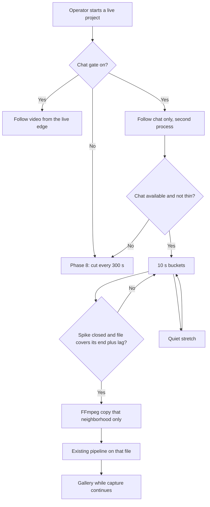

# Live chat spikes — R&D

**Workspace:** `/Users/apple/Desktop/Cliping`  
**Research date:** 17 November 2026  
**Decision this unblocks:** On a YouTube livestream that is still on air, can audience chat tell Cliping which seconds are worth clipping, so the pipeline does not transcribe every 5-minute window?  
**Status:** Research only. Not a phase. Capture of the broadcast stays [LIVESTREAM_CLIPS_RND.md](./LIVESTREAM_CLIPS_RND.md) and [plans/PHASE_8_LIVESTREAM_CLIPS.md](./plans/PHASE_8_LIVESTREAM_CLIPS.md).

This applies to `source_type=live` only. A finished video, a premiere that has ended, and an upload keep the pipeline they already have. Chat is not a ranking signal for those.

---

## Verdict

Yes, for a broadcast that is still live and has public chat. Read the chat while the existing follow records, turn message rate and a few explicit phrases into time ranges, and run normalize → ASR → proposals only on those ranges. Quiet minutes never enter the worker. That is the speedup. Whisper is the slow stage (about 0.3–1.5× realtime on CPU in architecture §14), and the worker runs one job at a time.

Chat does not contain the picture. A comment cannot be clipped. The bytes of that moment still have to be on disk. Phase 8 already records them in `follow.mp4.part`. `--download-sections` still does not work on an active livestream, so “see a spike, then download only that minute from YouTube” is not a design. The follow keeps running. What stops is the 5-minute cut that is sent through Whisper whether or not anyone reacted.

No paid dependency is required. The path that fits this repo is a second `yt-dlp` process that writes live chat and nothing else, plus a small scorer in the capture supervisor. The official Live Chat API is a free fallback with a daily unit cap, not a bill. Do not add a chat SaaS, a bot in the channel, or an LLM that reads every line.

Clips still appear after the moment, not on the comment. Viewers type after they see it, the cut has to stay behind the live edge, and Whisper still has to run on the short file. The gain is skipping the rest of the window, and not waiting for a 5-minute boundary before cutting a spike that already ended.

---

## What stays the same

| Input | Path |
| --- | --- |
| Upload | Unchanged. No chat. |
| Finished YouTube URL (`was_live`, `not_live`) | Unchanged URL ingest. Replay chat exists on many VODs and is out of this work. |
| `post_live` | Still refused, as Phase 8 does. |
| Live URL or local folder, chat gate off | Phase 8: a closed window every `LIVE_CHUNK_SEC` (300) goes through the pipeline. |
| Live URL, chat gate on, chat missing or too thin | Fall back to those same fixed windows for that project. Say so in the UI. |
| Folder-only capture | No YouTube chat. Fixed windows. Do not require a URL. |

---

## Options compared

| Option | Fit for Cliping | Cost | Local? | Risk |
| --- | --- | --- | --- | --- |
| **Second yt-dlp, `--skip-download --sub-langs live_chat`, score locally, cut only spikes from the follow file** | The one to spike. Same binary as capture. No new quota. Scorer is a pure function. | $0 | Yes. Network only to the chat the operator already pointed at. | Undocumented InnerTube, same ToS caveat as URL ingest. Chat JSON shape can break. Two processes: video and chat cannot share one yt-dlp (yt-dlp#413). |
| **Data API `liveChatMessages.list`, honor `pollingIntervalMillis`** | Works with the API key the Live now tab already uses. Public chat. Documented fields. | $0 inside the default **10,000 unit/day** bucket. **5 units per call.** Not the 100/day search bucket. | No. Needs Google. Off when `YOUTUBE_API_KEY` is unset. | A few hours of one busy stream can empty the shared bucket. Joining late does not return chat from before the first response. |
| **Data API `liveChatMessages.streamList` (gRPC)** | Google’s current recommendation instead of tight polling. One long connection, API key or OAuth. | Documented as **5 units per call**. Whether “a call” is the whole connection or each pushed batch was **not measured**. | No. Adds `grpcio`. | New protocol in the API container. Do not adopt it until a short broadcast shows the unit cost. |
| **Keep Phase 8 fixed 5-minute windows** | Already shipped. | $0 | Yes | Every window is transcribed, including dead air. First proposal waits for the chunk boundary. |
| **`--download-sections` of the spike on the live URL** | Looks like the fast path. | $0 | Yes | Still impossible on an active broadcast ([yt-dlp#13175](https://github.com/yt-dlp/yt-dlp/issues/13175)). Do not build on it. |
| **`superChatEvents.list`** | Super Chat is a strong signal, but this method is the **channel owner’s** event list. | 1 unit, OAuth | No | Useless for a public stream the operator does not own. Read `superChatEvent` on the chat itself. |
| **Viewer count over time** (`videos.list` `concurrentViewers`) | Cheap context. 1 unit per poll. | $0 in the shared bucket | No | A point sample, often hidden, and it moves after the moment. Not a cut boundary. |
| **Nightbot, StreamElements, or another chat bot** | Those bots sit in a channel the operator moderates. | Often paid | No | Wrong dependency. Cliping only needs to read. |
| **Ollama or a paid LLM on every chat line** | Can label a spike after it is cut. | Local $0, or a metered API | Ollama is local | Too slow and too easy to fool to decide the cut. The ranker already reads the transcript. |

---

## Why the download does not go away

Phase 8’s capture process follows the live edge into one growing mpegts (`follow.mp4.part`). A cutter copies a **closed** range with FFmpeg `-c copy` once that range ends at least `LIVE_EDGE_LAG_SEC` (20 s) before the file’s end. The pipeline then sees a normal finite file.

Chat changes which range is copied. It does not change where the bytes come from.

```text
today:     follow  → every 300 s  → pipeline
chat gate: follow  → scorer says "this 70 s"  → pipeline
           follow  → scorer says nothing      → no job
```

Disk stays in the same class as Phase 8, because the follow file still grows for the whole broadcast. Deleting the quiet middle of a file that yt-dlp is still appending is a later experiment, not this design. The worker’s CPU is what gets returned.

Using architecture §14’s CPU range, and only as an order of magnitude:

| Work | Fixed 300 s window | One 70 s neighborhood |
| --- | --- | --- |
| ASR | ~90–450 s | ~20–105 s |
| Quiet stretch with no spike | same ASR cost | no job |
| When the cut may start | next 300 s boundary, then the 20 s lag | after the spike has been quiet for ~20 s, then the 20 s lag, and only once the follow file covers that end |

A spike at minute 1 can be a proposal a few minutes later. Today that same moment waits out the rest of the 5-minute chunk and then a longer transcribe. The follow itself is realtime either way. Chat does not make the download faster. It makes the worker skip.

---

## How a message becomes a second in the file

Two clocks, and they must not be mixed.

**Broadcast time.** The official message field is `snippet.publishedAt` (ISO 8601). Subtract `liveStreamingDetails.actualStartTime` from `videos.list`. That is seconds since the broadcast went on air.

In a yt-dlp `.live_chat.json` line the equivalent is `timestampUsec` on the message (microseconds). `yt-dlp -J` exposes the broadcast start as `release_timestamp` (unix seconds). A check published 17 November 2026 against a finished replay found `timestampUsec / 1000 - release_timestamp * 1000` within about a quarter-second of the replay’s `videoOffsetTimeMsec` (median 91 ms on 11,997 lines). Use that subtraction.

**Do not use `videoOffsetTimeMsec` while `isLive` is true.** During the broadcast, yt-dlp fills that field from when the **chat download** started, not from when the broadcast started ([yt-dlp#489](https://github.com/yt-dlp/yt-dlp/issues/489)). On a replay, after the stream has ended, the same field is the real offset. This feature never waits for the replay.

**File time.** Phase 8 starts at the live edge, not at `actualStartTime`, and it does not pass `--live-from-start`. Position 0 in `follow.mp4.part` is the media that arrived when the follow process started. Record that wall time as `capture_started_at`.

```text
file_sec = (message_unix - capture_started_at) - reaction_sec
```

`reaction_sec` defaults to **15**. People type after the picture. Both the viewer at the live edge and our follow are near “now,” so this is mostly human delay, not the full HLS glass-to-glass delay. It is still an estimate. A low-latency stream and a normal-latency stream will not match the same 15 s. The first spike on a stream the operator has rights to has to compare one known moment (“say clip now”) with the file. Until that note exists, keep the padding wide enough that a wrong bias still lands inside the cut.

**Padding.** Chat picks a neighborhood. The existing ranker still picks the sentence.

- Start the cut at `file_sec - 20` of the first hot message.
- End it at `file_sec + 10` of the last hot message.
- If that is under `CLIP_MIN_SEC`, widen from the center until it is at least that long, without crossing the live edge.
- If it is over **90 s**, still cut it, capped at **180 s**, and let propose-windows choose 20–60 s inside it. Do not invent a second ranker on the chat text.
- Never copy a range that reaches the current end of `follow.mp4.part`. Same 20 s lag as Phase 8.

Messages are deduped by id. A reconnect replays recent lines; drop ids already seen. Ignore `tombstone`, ban events, sponsor-only mode events, and `chatEndedEvent` except as a signal to stop the follower.

---

## What counts as interesting

Score **10-second buckets**. The decision is numeric. No model.

A bucket stores a count, the number of distinct author channel ids, and the share of messages that collapse to the same normalized string. Author ids stay in memory for the count. They are not written to the database.

**Fire a spike when any of these holds:**

1. **Rate.** After 120 s of baseline, a bucket’s count is at least `max(8, 3 × median)` and at least **4** distinct authors. Two hot buckets in a row count as one spike. Two quiet buckets end it.
2. **Ask.** Inside 20 s, at least **3** distinct authors send a clip-intent line. Default phrases, matched on the normalized line, not as a substring of a paragraph: `clip`, `!clip`, `clip that`, `omg`, `wtf`, `lmao`, `no way`, `insane`, `lets go`. The list is an env value so a non-English channel can replace it. Rate spikes do not need these words. A non-English chat still works through (1) and (3).
3. **Paid highlight, which we do not pay for.** One `superChatEvent` or `superStickerEvent` inside a bucket that is already above the median. A Super Chat alone in a dead chat is a weak clip (people thank the donor). Require the surrounding 20 s to be at least the median rate, or pair it with (2).

**Do not fire when:**

- More than about **70%** of the bucket is the same normalized line. That is a raid greeting or a copypasta, not a moment. A Super Chat or a diverse bucket beside it can still fire.
- The project is still inside the first 120 s, unless (2) or a Super Chat-plus-median hits. There is no median yet. Do not clip “the start” just because chat is saying hello.
- The whole project is thin: under **4** messages per minute once 5 minutes have been observed. Turn the gate off for the rest of that project and use fixed windows. One decision, no flapping.
- Chat never appeared: no `live_chat` format, `activeLiveChatId` empty, or the API returns `liveChatDisabled` / `liveChatEnded`.

One user spamming `clip` does not pass (2). Membership gifts and new-member announcements are not clip signals.

The first request to the official API returns **recent** messages only. It does not backfill the broadcast. That matches capture, which also starts at the live edge. Missed lines on a flood (more than `maxResults` in one poll, 200–2000) still leave a high bucket. A single missed `!clip` can be lost. Accept that.

---

## Architecture

Chat follow and scoring live in the Phase 8 capture supervisor. They are not Arq jobs. The worker still has `max_jobs=1` and still only sees a finite file. Upload and URL code paths do not import this module.



**Processes**

| Process | Role |
| --- | --- |
| API | Starts and stops one live project, as today. |
| Capture supervisor | Runs the video follow. Tails the chat file. Owns the scorer. Cuts. Enqueues. |
| Chat yt-dlp | `--skip-download --write-subs --sub-langs live_chat`. No cookies, no `--live-from-start`, no `--download-sections`. Writes JSON lines under `data/<id>/capture/chat/`. |
| Video yt-dlp | Unchanged Phase 8 follow. |
| Arq worker | `run_pipeline` on each cut file. Never on `follow.mp4.part`. Never on the chat file. |

**Rows.** A `live_spikes` table next to `live_windows`: `project_id`, broadcast start/end, file start/end, message count, distinct authors, reason (`rate`, `ask`, `super`), status (`queued` / `running` / `ready` / `failed`). Store up to a handful of truncated display strings for the operator. Do not store the chat log. Overlap between two spikes uses the Phase 8 rule: if the broadcast intervals overlap by more than half the shorter one, keep the higher score.

**Settings**, all defaulting so today’s behavior is unchanged:

| Key | Default | Meaning |
| --- | --- | --- |
| `LIVE_CHAT_GATE` | `off` | `off` is Phase 8. `spike` is this design. Requires `ALLOW_LIVE_INGEST`. |
| `LIVE_CHAT_REACTION_SEC` | `15` | Subtract from the message time before cutting. |
| `LIVE_CHAT_BUCKET_SEC` | `10` | Scorer window. |
| `LIVE_CHAT_PHRASES` | the short list above | Comma-separated, whole-line match after lowercasing. |

No new secret. The yt-dlp path does not read `YOUTUBE_API_KEY`.

**UI.** The live project already shows windows and Stop. Add one line of state: `chat gate on — 2 spikes, quiet minutes skipped` or `chat unavailable — clipping every 5 min`. Gallery times stay `stream_offset_sec`. Do not render a chat replay.

**Static and URL forms.** No checkbox, no probe, no extra yt-dlp. A `was_live` URL that still has replay chat is a tempting shortcut and is rejected here on purpose: the operator asked for the current pipeline on finished videos, and `--download-sections` on a VOD is a different project.

---

## Paid dependencies

None required.

| Piece | Bill |
| --- | --- |
| yt-dlp chat follow | $0. Already in the API image. |
| Scorer | $0. Python in the supervisor. |
| FFmpeg cut and the existing pipeline | $0. Already local. |
| YouTube Data API, if the yt-dlp chat spike fails | $0 at the default quota. `liveChatMessages.list` and `streamList` are **5 units** in the shared 10,000-unit bucket. `videos.list` to read `activeLiveChatId` and `actualStartTime` is **1 unit**. Search (`search.list`) is a separate 100-call bucket and is not spent by chat. `videos.insert` is its own bucket, so this does not spend upload quota. |
| Raising that 10,000 cap | Not a price on the quota page. It is a Google approval. Do not plan on getting it. |
| Super Chat money | The viewer pays the creator inside YouTube. Cliping does not take a cut and does not need a payment integration to **see** the event. |
| Ollama | Optional later, to title a spike. Not on the cut path. Already optional in this repo. |

Quota arithmetic for the REST fallback, if `pollingIntervalMillis` comes back at 5 s or 10 s. Google tells the client the wait. Polling faster returns `rateLimitExceeded` and still costs units on a call that errors.

| Interval | Calls per hour | Units per hour | Hours until 10,000 |
| --- | --- | --- | --- |
| 5 s | 720 | 3,600 | ~2.7 |
| 10 s | 360 | 1,800 | ~5.5 |

Those hours are for **one** chat follow, and the bucket is shared with `videos.list` and the rest of the non-search API. A 4-hour stream at a 5 s interval does not fit. That is why the default reader is yt-dlp, and why the API is only a measured fallback. `streamList` is documented as the way to avoid this polling cost. Its real unit use on a long connection was not measured on 17 November 2026. A September 2026 issue confirmed `list` deducts 5 even when a doc page briefly said 1; the quota calculator and the method page both say 5 now.

Official chat dies when the broadcast ends (`liveChatEnded`). There is no documented API to read replay chat afterwards. yt-dlp can download replay chat on a finished video. That is the VOD feature this doc is not building.

---

## Fallback and failure

| Event | Behavior |
| --- | --- |
| Gate `off` | Phase 8 windows. |
| No chat format, chat disabled, members-only, made-for-kids | Fixed windows. UI says chat was unavailable. |
| Thin chat after 5 min | Fixed windows from then on. Spikes already cut stay. |
| Chat process dies, video follow still healthy | Fixed windows until chat is back. Do not stop the recording. |
| Video follow dies | Phase 8 stop rules. Chat process is killed with it. |
| Spike cut fails ffprobe | Store `error` on that spike. Keep recording. |
| Two spikes overlap | Keep the higher score, reject the other with `overlap`. |
| Operator hits Stop | Cut a spike whose range is already closed. Drop one that is still open. Leave proposals. |

A failed chat reader must not delete `follow.mp4.part` and must not block the worker.

---

## Rights

Same two layers as architecture §1. Reading public chat does not create a right to record the broadcast. The yt-dlp chat follow is the same contractual problem as the video follow. The official API is the path that stays inside Google’s API terms, and it is the fallback, not the default, because of quota.

Do not log author channel ids. Do not build a viewer list. Do not post into the chat (`liveChatMessages.insert` is a write, 20 units, and it is not this feature). No cookies, no membership bypass, no attempt to read a chat the probe says is disabled.

---

## What has to be proved before any route

On a stream the operator has rights to, beside the Phase 8 follow:

1. A second yt-dlp with `--skip-download --write-subs --sub-langs live_chat` appends JSON lines while the video follow is running. Note the yt-dlp version.
2. For one message, `timestampUsec` minus the broadcast start is sane, and `videoOffsetTimeMsec` is **not** that value while `isLive` is true.
3. A spoken cue and a burst of chat land in the follow file within `reaction_sec + 20` of the formula above. Write the measured bias.
4. A quiet stretch produces no cut. A synthetic burst (or a real one) produces one file shorter than the surrounding 5 minutes, and that file is what `run_pipeline` receives.
5. Killing the chat process leaves the video follow and any earlier cut playable.

If (1) fails, stop. Measure `streamList` unit cost on a short broadcast before writing a gRPC client. Do not switch the design to `--download-sections`.

The scorer itself can be unit-tested with no network: buckets, the 70% duplicate rejection, the three-author ask, the thin-chat fallback, and the file-time formula.

---

## Build plan, not scheduled

Do not start this while another phase is open. It is a change on top of Phase 8, behind `LIVE_CHAT_GATE=off`.

1. Scorer module and tests. No I/O.
2. Spike the five checks above. Write the result at the bottom of this doc.
3. Supervisor tail + cut + enqueue, only when the gate is `spike`.
4. `live_spikes` migration and one status field on the live project payload.
5. One line in the live project UI. No chat pane.
6. README and `.env.example`. Architecture §7.1 stays “closed windows through the normal pipeline.” This doc is the exception for which windows.

Leave out: Twitch and Kick chat, replay chat on VODs, posting a clip because chat spiked, an LLM on the chat log, deleting quiet bytes from the follow file, and any change to upload or URL ingest.

---

## Sources

Accessed 17 November 2026.

- YouTube Data API, `liveChatMessages.list`: 5 units; first response is recent history only; then `nextPageToken` and `pollingIntervalMillis`. The API does not return messages older than that first page. <https://developers.google.com/youtube/v3/live/docs/liveChatMessages/list>
- YouTube Data API, `liveChatMessages.streamList`: server stream, 5 units per call, API key or OAuth. Errors include `liveChatDisabled` and `liveChatEnded`. <https://developers.google.com/youtube/v3/live/docs/liveChatMessages/streamList>
- Streaming Live Chat guide: `videos.list` → `liveStreamingDetails.activeLiveChatId`; the Python sample takes an API key. <https://developers.google.com/youtube/v3/live/streaming-live-chat>
- `liveChatMessage` resource: `publishedAt`, `textMessageEvent`, `superChatEvent`, `superStickerEvent`. Chat is available while the live event is active. <https://developers.google.com/youtube/v3/live/docs/liveChatMessages>
- Quota calculator: default 10,000 units/day for methods other than `search.list` and `videos.insert`; `liveChatMessages.list` and `streamList` cost 5. <https://developers.google.com/youtube/v3/determine_quota_cost>
- Issue 568019528 (September 2026): Google confirmed `liveChatMessages.list` deducts 5 units per call. <https://issuetracker.google.com/issues/568019528>
- yt-dlp PR 422: realtime live chat, separate process from the video download, `isLive` on the JSON line. <https://github.com/yt-dlp/yt-dlp/pull/422>
- yt-dlp#489: while the stream is live, `videoOffsetTimeMsec` is relative to the chat download, not the broadcast. <https://github.com/yt-dlp/yt-dlp/issues/489>
- yt-dlp#13175: `--download-sections` cannot target an active livestream. <https://github.com/yt-dlp/yt-dlp/issues/13175>
- Stack Overflow 80002229: no documented API for live chat replay after the chat has ended. <https://stackoverflow.com/questions/80002229/is-there-an-official-way-to-access-live-chat-replay-after-a-youtube-livestream-h>
- Replay offset check, 11,997 lines, `timestampUsec` against `release_timestamp`: <http://bizu.is-a.dev/blog/notes/youtube-live-chat-time-from-timestampusec/>
- This repo: [LIVESTREAM_CLIPS_RND.md](./LIVESTREAM_CLIPS_RND.md), [plans/PHASE_8_LIVESTREAM_CLIPS.md](./plans/PHASE_8_LIVESTREAM_CLIPS.md), architecture §7.1 and §14.
