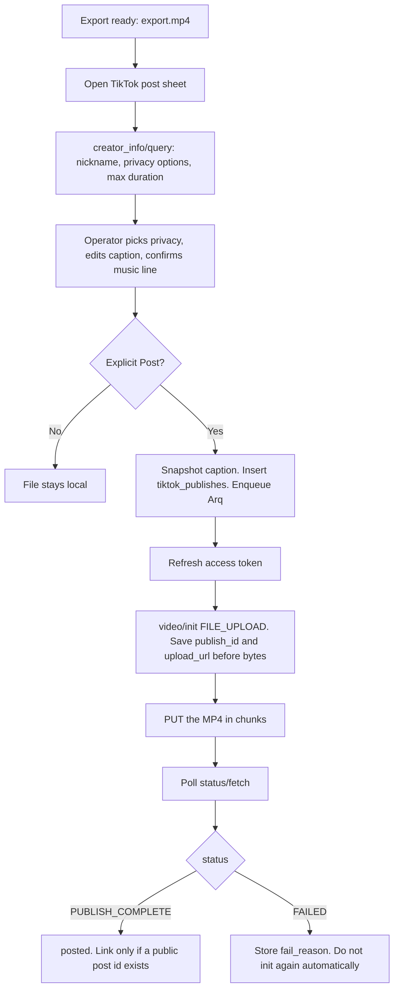

# TikTok publish — R&D

**Workspace:** `/Users/apple/Desktop/Cliping`  
**Research date:** 16 November 2026, rechecked the same day against the live developer pages  
**Decision this unblocks:** After a clip is exported, can Cliping post that file to the operator’s own TikTok account the way Phase 6 posts to YouTube, and what is different?  
**Status:** Ready to implement. No TikTok code is in the repo. The playbook is [plans/PHASE_7_TIKTOK_PUBLISH.md](./plans/PHASE_7_TIKTOK_PUBLISH.md). YouTube stays a separate flow: [YOUTUBE_PUBLISH_RND.md](./YOUTUBE_PUBLISH_RND.md).

Recheck found two facts the first draft had wrong. Implement from the corrected versions below, not from memory of the first draft:

1. **Token lifetimes.** [Manage OAuth Access Tokens](https://developers.tiktok.com/doc/oauth-user-access-token-management), updated 5 November 2026, says the access token lasts **2 hours** (`expires_in`) and the refresh token lasts **180 days** (`refresh_expires_in`). Store those response fields. Do not hardcode 24 hours or 365 days. Every refresh returns a **new** refresh token; keeping the old one makes the next refresh fail.
2. **Redirect port.** The browser reaches this app at `http://localhost:3001`. Compose maps that to container port 3000. TikTok must redirect to the host URL the browser uses: `http://localhost:3001/api/backend/api/v1/tiktok/callback`. Port 3000 is the container’s own port and is the wrong Desktop URI.

---

## Verdict

Yes, as its own flow. The supported path is TikTok’s **Content Posting API — Direct Post**: `POST /v2/post/publish/video/init/` with `source=FILE_UPLOAD`, then `PUT` the existing `export.mp4` to the returned `upload_url`, then poll `POST /v2/post/publish/status/fetch/`. Scope is `video.publish`. There is no separate Shorts-style endpoint and no `publishAt`. A vertical H.264 MP4 at 1080×1920 under 3 minutes fits the published media rules, which matches what Cliping already exports, with two checks called out below (frame rate, watermark).

The product rule stays **approve, then upload**. Finishing an export must not post. The operator sees the TikTok account name, picks a privacy value TikTok just returned for that account, and clicks Post. The worker sends that exact file and the caption snapshotted at click time.

This is not a copy of the YouTube worker. TikTok has no resumable session that returns the same video if you start again, no native schedule, a hard private-only mode until TikTok audits the app, and a post screen TikTok’s guidelines specify in detail. Keep it in `app/tiktok/`, its own table, and its own button. Leave `app/youtube/` alone.

An unaudited app can post only to a **private** TikTok account, and only as **Only me** (`SELF_ONLY`). Public, friends, and followers wait on a TikTok audit. That audit is a manual portal submission. TikTok’s own examples of unacceptable apps include a tool whose purpose is uploading to accounts you manage, and an app that copies arbitrary content from other platforms. Cliping is a local tool for one operator and can ingest a YouTube URL, so a public-posting audit may be refused. The phase should ship the private path and not promise a public feed.

---

## Options compared

| Option | Fit for Cliping | Cost | Local? | Risk |
| --- | --- | --- | --- | --- |
| **Direct Post `FILE_UPLOAD`** from the Arq worker | Posts the file we already encode. Official. Works on localhost because the bytes leave the machine; TikTok does not fetch us. | $0 API fee. A TikTok developer app. About **15 posts per account per 24 hours**, shared with every other API client, and the cap varies by creator. | Pipeline stays on disk. The upload is the only required network step. | Unaudited = private only. A second init after a crash can create a second post. No native schedule. |
| **Direct Post `PULL_FROM_URL`** | TikTok downloads a public HTTPS URL. | $0 | No | Needs a verified domain and a public file. Fights local-first. Do not use. |
| **Inbox upload** (`video.upload`, draft in the TikTok app) | Official, and it avoids some direct-post rules. | $0 | Yes | The user still has to finish the post inside TikTok. That is not “one click posts.” Do not build it as the product path. |
| **Download the MP4 and post in the TikTok app** | Already possible. Keep it as the fallback. | $0 | Yes | No automation. |
| **Third-party poster** (Ayrshare, Buffer, and similar) | Same underlying API, vendor holds the token. | Subscription | No | Extra terms and an extra outage. Fights local-first. |
| **Drive the TikTok website or app** | Looks like automation. | $0 | Local | Fragile, unsupported, account risk. Do not build. |
| **Session cookies or private upload endpoints** | Not a product path. | — | — | Account loss. Do not build. |

---

## Recommendation

Build this as **Phase 7**, after the gallery and `export.mp4` from Phase 5 exist. It does **not** depend on YouTube credentials, the YouTube table, or Phase 6 being finished. Do not start it in the same run as Phase 6.

Keep one TikTok account. Feature off when `TIKTOK_CLIENT_KEY` is empty, so the clipper and the YouTube flow still run with no TikTok app.

**Ship in that phase**

1. **Connect TikTok** once, using Login Kit’s **Desktop** rules (loopback `http://localhost` is allowed there; the Web rules require public `https` and reject localhost).
2. A TikTok bar on the gallery, separate from the YouTube bar: account nickname, caption preview, privacy the operator must choose, interaction switches, commercial-content disclosure, the Music Usage Confirmation line, one **Post N clips** button.
3. An Arq job `run_tiktok_publish` that uploads `export.mp4` unchanged and stores TikTok’s `publish_id` before any byte is sent.
4. Status on the card: uploading → processing → posted / failed. A public post id is shown only when TikTok returns one.

**Leave out of that phase**

- Posting when export finishes, with no click.
- Changes to YouTube OAuth, `youtube_publishes`, or the YouTube button.
- Inbox drafts, photo posts, `PULL_FROM_URL`, webhooks, analytics, comments, or a public callback URL.
- A TikTok-native schedule. The API has no `publishAt`. A later slice can hold the job locally and call init at the slot; the computer must stay on, and that is not a scheduled post inside TikTok. Phase 7 posts the batch now.
- Submitting the TikTok audit. Document the steps. Passing it is outside the phase.
- Re-encoding the export inside the publish job.

**Library:** `httpx`, already in `services/api`. There is no official Python SDK to adopt. Do not add a third-party TikTok package.

**Where the code goes.** New modules only: `app/tiktok/oauth.py`, `app/tiktok/upload.py`, routes under `/api/v1/tiktok/`, table `tiktok_publishes`, worker function `run_tiktok_publish` added to the list in `app/worker.py`. Mirror the YouTube callback shape in `app/api/routes/youtube.py` and the proxy’s `redirect: "manual"` in `apps/web/src/app/api/backend/[...path]/route.ts`. Do not edit `app/youtube/`, `youtube_publishes`, or the YouTube React bar except to place a second pill beside it.

**Worker:** `max_jobs=1` already posts one clip at a time. Init is capped at **6 requests per minute per user token**, so a fast batch must not fire inits in a tight loop. One job at a time is enough if the worker does not start the next init in the same second as the last.

---

## Required flow



What the operator does once, in the TikTok developer portal, before any of that:

1. Create an app at [developers.tiktok.com](https://developers.tiktok.com/).
2. Add **Login Kit** and the **Content Posting API** with **Direct Post** enabled.
3. Register the redirect as a **Desktop** URI, exactly `http://localhost:3001/api/backend/api/v1/tiktok/callback`. Desktop allows `http` on `localhost` or `127.0.0.1` only, with a port, static, no query string. A Web redirect URI will not accept this. Use 3001 because that is the host port in `docker-compose.yml` and in `YOUTUBE_REDIRECT_URI`. Do not register port 3000.
4. Add scopes `user.info.basic` and `video.publish` on the app. The user must grant both. `video.publish` is what allows the post and the creator-info query.
5. Put the client key and client secret in env, not in git.
6. In Cliping, click **Connect TikTok** and approve the consent screen with the account that should receive the posts.
7. For the first posts, set that TikTok account to **Private** and choose **Only me**. Until TikTok audits the app, a public account or any wider privacy is rejected with `unaudited_client_can_only_post_to_private_accounts`.

---

## How this differs from YouTube

| | YouTube (Phase 6) | TikTok (this research) |
| --- | --- | --- |
| Call | Resumable `videos.insert` | `video/init` + `PUT` + `status/fetch` |
| Identity | Google OAuth, `youtube.upload` | Login Kit, `video.publish` + `user.info.basic` |
| Local redirect | Web client, loopback through the Next proxy | Desktop Login Kit. Web Login Kit forbids localhost. |
| PKCE | Google’s flow | Required. Challenge is **hex** SHA-256 of the verifier, not base64url. |
| Schedule | `status.publishAt` on a private video | No field. Posting is immediate. |
| Privacy | public / unlisted / private, default private is allowed | Must be one of `privacy_level_options` from a fresh creator-info call. Guidelines say the dropdown has **no default**. |
| Who can see an unaudited post | Test users can receive a private video; public is possible on your own unverified app | Only `SELF_ONLY`, and the account must be private |
| Status read | `videos.list` needed a read scope we did not request at first | `status/fetch` uses the same `video.publish` scope as the upload |
| Duplicate safety | Resume the saved session URI; a new insert makes a second video | Resume the saved `upload_url` while it is valid (1 hour). A new init is a new post. |
| Caption | Title (100) and description are separate fields | One `title` field, max **2200 UTF-16 code units**, hashtags included |
| Daily cap | 100 `videos.insert` units, separate bucket | About 15 Direct Posts per account per 24 hours, shared by every app, plus 6 inits per minute |
| Link | Watch URL as soon as the video id exists | `publicaly_available_post_id` only after a **public** post passes moderation. A private post can be `PUBLISH_COMPLETE` with an empty id list. The field name is TikTok’s spelling. |

---

## OAuth

Authorize URL: `https://www.tiktok.com/v2/auth/authorize/`

Query parameters: `client_key`, `scope` (`user.info.basic,video.publish`), `response_type=code`, `redirect_uri`, `state`, `code_challenge`, `code_challenge_method=S256`.

PKCE, from the Desktop guide (last updated 4 August 2026):

- New verifier on every connect, 43–128 characters from `[A-Z] / [a-z] / [0-9] / "-" / "." / "_" / "~"`.
- `code_challenge` is the hex digest of SHA-256 over the verifier string. TikTok’s sample uses `CryptoJS.SHA256(verifier).toString(CryptoJS.enc.Hex)`. The same Desktop page’s Node sample then puts the raw verifier in the `code_challenge` query parameter. That line is wrong. Send the hex digest.
- Send `code_verifier` on the token exchange. Desktop and mobile require it. Web does not, and Web is the wrong platform for this app.

Token URL: `POST https://open.tiktokapis.com/v2/oauth/token/` with `Content-Type: application/x-www-form-urlencoded`.

Authorization-code grant fields: `client_key`, `client_secret`, `code`, `grant_type=authorization_code`, `redirect_uri`, `code_verifier`. The code must be URL-decoded. The redirect URI must match the authorize request exactly.

Official token lifetimes, from the token guide updated 5 November 2026: `access_token` **2 hours** (`expires_in`), `refresh_token` **180 days** (`refresh_expires_in`). Both fields are the remaining lifetime in seconds. Refresh with `grant_type=refresh_token` before `expires_in` runs out. The response contains a **different** refresh token every time; store that one and drop the old one. A later refresh that still sends the replaced token fails and the operator must connect again. Do not hardcode 24 hours or 365 days.

Store the token file at `DATA_DIR/secrets/tiktok_token.json`, mode `0600`, gitignored, never under `/files`, never logged. Same rule as the YouTube token file, different path. Log `publish_id` and `fail_reason` only. Never log the access token, refresh token, client secret, `code_verifier`, or `upload_url` (the URL carries `upload_token`).

Disconnect: revoke through the token endpoint documented in [User access token management](https://developers.tiktok.com/doc/oauth-user-access-token-management), then delete the file. If revoke fails because the token is already dead, still delete the file.

The callback must go through the Next proxy (`/api/backend/...`) so `API_TOKEN` still applies, same reason as YouTube. The proxy must leave TikTok’s redirect status and `Location` alone long enough for the browser to return to Cliping. Confirm that when the phase is built; do not assume the YouTube proxy tweak covers a second provider without looking.

`user.info.basic` is enough for a header label (avatar and display name). The post sheet must use `creator_nickname` from creator info, not a cached display name from connect day. Guidelines require the nickname on the post page itself.

---

## Creator info, then init

Call this when the operator opens the TikTok post sheet, and again if the sheet has been open long enough that the result may be stale. Do not cache it for the life of the process.

`POST https://open.tiktokapis.com/v2/post/publish/creator_info/query/`  
Scope: `video.publish`. Limit: **20 requests per minute** per user token.

Fields the UI must honor:

| Field | Use |
| --- | --- |
| `creator_nickname` | Shown on the post sheet so the operator sees which account receives the file |
| `creator_username` | Secondary label |
| `creator_avatar_url` | Optional. The URL expires in about 2 hours. |
| `privacy_level_options` | The only legal values for the privacy dropdown. Public account: `PUBLIC_TO_EVERYONE`, `MUTUAL_FOLLOW_FRIENDS`, `SELF_ONLY`. Private account: `FOLLOWER_OF_CREATOR`, `MUTUAL_FOLLOW_FRIENDS`, `SELF_ONLY`. |
| `comment_disabled`, `duet_disabled`, `stitch_disabled` | If true, that interaction control is disabled and the init body sends `disable_*=true` |
| `max_video_post_duration_sec` | Reject the clip before init when the export is longer |

Errors from this call that should stop the sheet: `spam_risk_too_many_posts`, `spam_risk_user_banned_from_posting`, `reached_active_user_cap`. Tell the operator to try later. `access_token_invalid` means refresh or reconnect. `scope_not_authorized` means they did not grant `video.publish`.

Init, only after the click:

`POST https://open.tiktokapis.com/v2/post/publish/video/init/`  
Limit: **6 requests per minute** per user token. `Content-Type: application/json; charset=UTF-8`.

```json
{
  "post_info": {
    "title": "caption including #hashtags",
    "privacy_level": "SELF_ONLY",
    "disable_duet": false,
    "disable_comment": false,
    "disable_stitch": false,
    "video_cover_timestamp_ms": 0,
    "brand_content_toggle": false,
    "brand_organic_toggle": false,
    "is_aigc": false
  },
  "source_info": {
    "source": "FILE_UPLOAD",
    "video_size": 4194304,
    "chunk_size": 4194304,
    "total_chunk_count": 1
  }
}
```

`privacy_level` and both brand toggles are required. `title` is the whole caption. Hashtags and `@` mentions are detected when separated by spaces or newlines. Omit `title` only when the operator cleared the caption. `is_aigc` labels the video as AI-generated. A Gemini-written caption is not a reason to set it. Default false, with an explicit checkbox.

Success returns `publish_id` (max 64 characters) and `upload_url` (documented max 256 characters; store it as text anyway). **`upload_url` is valid for one hour.** Save both before the first `PUT`.

Init errors worth mapping:

| `error.code` | What to do |
| --- | --- |
| `unaudited_client_can_only_post_to_private_accounts` | Stop the batch. The account is public, or the privacy is wider than `SELF_ONLY`, and the app is not audited. |
| `privacy_level_option_mismatch` | The click used a privacy value that was not in the latest creator-info list. Fail this attempt. Do not guess another value. |
| `spam_risk_too_many_posts` | Stop the batch. The account hit the daily Direct Post cap. |
| `spam_risk_user_banned_from_posting` | Stop the batch. |
| `reached_active_user_cap` | Stop the batch. Unaudited clients: 5 posting users per 24 hours. Irrelevant for one operator unless something else is posting. |
| `rate_limit_exceeded` | Do not init again immediately. Retry this same row later. |
| `access_token_invalid` / `scope_not_authorized` | Refresh once. If that fails, mark disconnected and stop the batch. |
| `invalid_param` | Fail the row with TikTok’s message. Do not retry forever. |
| 5xx | Retry the init only if no `publish_id` was stored. |

`url_ownership_unverified` applies to `PULL_FROM_URL`. We should not see it.

---

## Upload and status

`PUT` the entire `upload_url`, query string included.

Headers: `Content-Type: video/mp4`, `Content-Length` of this chunk, `Content-Range: bytes {first}-{last}/{total}`.

Chunk rules from the media guide (last updated 4 August 2026):

- Under **5 MB**: one chunk, `chunk_size` equals the file size, `total_chunk_count` is 1.
- **5 MB through 64 MB**: one chunk is allowed. Cliping Shorts should take this path. `chunk_size` equals the file size.
- Over **64 MB**: several chunks of 5–64 MB. `total_chunk_count = floor(video_size / chunk_size)`. The last PUT is `chunk_size` plus the leftover bytes, not a tiny tail by itself. TikTok’s 50,000,123-byte example uses `chunk_size` 10,000,000 and five chunks; the last body is 10,000,123 bytes. That last body may exceed `chunk_size` and must stay ≤ **128 MB**. A leftover smaller than 5 MB sent as its own chunk is invalid.
- 1 to 1000 chunks. Send them in order.
- `201` means every chunk is in and TikTok will post. `206` means this chunk landed and more remain. The response `Content-Range` reports how many bytes TikTok has.
- `400` is a bad header or a body length that does not match `Content-Length`. `403` means the `upload_url` expired. `404` means TikTok has no such upload. `416` means the range does not match progress. `5xx` means retry **this chunk**, not a new init.

A 10-clip batch of Shorts is ten inits and ten small PUTs. That is inside the spirit of the daily cap and outside the 6-per-minute cap if they are sequential.

Status: `POST https://open.tiktokapis.com/v2/post/publish/status/fetch/` with `{ "publish_id": "..." }`. Limit: **30 requests per minute**. Poll a handful of times with backoff, then requeue. Do not tight-loop. Do not register a webhook; this box has no public URL, and the poll is the documented alternative.

| `status` | Meaning for Direct Post |
| --- | --- |
| `PROCESSING_UPLOAD` | Bytes still going in, or TikTok is still accepting them |
| `PUBLISH_COMPLETE` | The post is up. For a private post this can happen with no public id. |
| `FAILED` | Stop. Store `fail_reason`. |

`PROCESSING_DOWNLOAD` and `SEND_TO_USER_INBOX` belong to the paths we are not building.

`publicaly_available_post_id` is a list. TikTok returns ids only after a public post clears moderation, which is often about a minute and sometimes hours. Private posts do not get this id. The card should say **Posted (private)** without a link in that case, and show a link only when an id arrives. Do not invent `https://www.tiktok.com/@user/video/{id}` until an id is present; confirm the URL shape against a real private-then-public post during the smoke test rather than hard-coding a guess now.

`uploaded_bytes` is documented as **1-indexed**. Treat a resume offset as something to check against a real `Content-Range` during implementation, not as `uploaded_bytes - 1` copied blindly from this note.

Fail reasons that mean “this file will not pass; do not upload it again”:

- `file_format_check_failed`
- `duration_check_failed`
- `frame_rate_check_failed`
- `picture_size_check_failed`
- `spam_risk_text` (caption)
- `spam_risk`

`spam_risk_too_many_posts` on the status poll stops the rest of the batch. An unnamed server-side fail reason in the same table is described as retryable (“some parts of the TikTok server may currently be unavailable”). Retry the **status poll**, not a new init, when the `publish_id` already exists.

Processing time for our file sizes should be seconds. The guide’s examples are half a minute at 512 MB. Moderation, when the post is public, is extra and can be hours. The worker should not sit inside one job for hours. Poll a few times, then requeue with a delay while the row stays `processing`.

---

## Media we already have

From the media guide:

| Rule | Limit | Cliping export |
| --- | --- | --- |
| Container | MP4 recommended; WebM and MOV also allowed | MP4 |
| Codec | H.264 recommended; H.265, VP8, VP9 allowed | `libx264`, `yuv420p`, AAC when the source has audio |
| Frame size | 360–4096 on each side | 1080×1920 |
| Duration | Every creator can post 3 minutes; some can post 5 or 10. The init path itself will not take more than 10 minutes. The creator-info value is the one to enforce. | Phase 6 already rejects exports over 180 seconds. Still compare with `max_video_post_duration_sec`. |
| File size | 4 GB | A Short is far under 64 MB, so one chunk |
| Frame rate | **23–60 fps** | The export command does **not** set `-r`. It keeps the source frame rate. A 24/30/60 fps source is fine. A source under 23 fps fails with `frame_rate_check_failed`. Probe before init and refuse with a clear message. Do not re-encode inside the publish job. |

Captions are burned into the picture. TikTok does not receive an SRT. That matches how the file is already built.

**Watermark.** TikTok’s content-sharing guidelines forbid a brand name, logo, watermark, or promotional text burned into the posted video. Cliping’s watermark is off unless `WATERMARK_TEXT` or `WATERMARK_IMAGE` is set. If either is set, the TikTok post must refuse that export and tell the operator to turn the watermark off and export again. Do not strip the watermark in the publish job, and do not send the marked file.

**Rights.** URL ingest can produce a file the operator does not own. TikTok’s guidelines also say the acceptable use is original content from the creator, and they call out copying from other platforms as not acceptable. Keep the rights checkbox. A successful API call is not a license.

**Music line.** The post button stays disabled until the operator accepts this sentence, which TikTok requires on the declaration: “By posting, you agree to TikTok's Music Usage Confirmation.” If they turn on branded content, the sentence changes to include the Branded Content Policy. Phase 7 can ship with commercial disclosure **off** and the music sentence required, and still show the disclosure controls because the guidelines require them on the post page.

---

## Caption, privacy, and the post page

Compose one caption from the saved post text: title, a newline, then the description (which already holds the hashtags from Phase 5). Snapshot that string onto the publish row at click time. Send that string as `post_info.title`. Count **UTF-16 code units** (TikTok’s page says “2200 in UTF-16 runes”). Python `len()` is the wrong counter for emoji. Reject over 2200 before init. The operator can edit the gallery text first; the sheet shows the exact caption that will be sent.

Privacy dropdown, from the guidelines (last updated 4 August 2026):

- Options are exactly `privacy_level_options` from the latest creator-info response.
- No pre-selected value. The operator chooses. This is stricter than YouTube, where private is the default.
- Map labels in the UI: Everyone, Friends, Followers, Only me. Send the enum, not the label.

Interaction switches for comment, duet, and stitch:

- Unchecked to start. The user turns one on. The API fields are the inverse (`disable_comment` and so on).
- If creator info says that interaction is disabled, the control is greyed and the body sends `disable_*=true`.

Commercial content, off by default:

- Off: `brand_content_toggle=false`, `brand_organic_toggle=false`, music sentence as above.
- “Your brand” → `brand_organic_toggle=true`, and the sheet says the video will be labeled promotional content.
- “Branded content” → `brand_content_toggle=true`, labeled paid partnership. Not allowed with Only me. If they pick Only me, branded content stays disabled.
- Disclosure on with neither box checked: Post stays disabled.

`video_cover_timestamp_ms` can be `0` (first frame). A cover picker is out of scope.

---

## Caps that matter for a 10-clip batch

From the Direct Post guidelines, for every client, audited or not:

- **Posting cap:** a limit per creator per 24 hours through Direct Post, “typically around 15 posts per day,” shared across all API clients that post for that creator. Ten clips fit once. A second full batch the same day may not. Do not hardcode 15 as a client-side quota; stop when TikTok returns `spam_risk_too_many_posts`.
- **Creator cap:** a 24-hour active-creator cap based on the numbers in the audit form. One operator is inside an unaudited cap of **5 users per 24 hours**.
- **Unaudited viewership:** `SELF_ONLY` only, and the account must be private at post time. Making the video public later is done by the account owner inside TikTok: switch the account to public, then change each video. The API does not do that flip for an unaudited client.

Init 6/minute, creator info 20/minute, status 30/minute. A `429` is `rate_limit_exceeded`, which is separate from the daily post cap.

---

## Idempotency

This is the part most likely to double-post.

1. One row per attempt, keyed so the same `export_hash` cannot have two active rows (`queued`, `uploading`, `processing`, `posted`).
2. Persist `publish_id` and `upload_url` in the same write that happens **before** the first byte.
3. If `publish_id` is set, the next run polls. It does not call init again.
4. If the PUT dies mid-file and the URL is still inside its hour, continue from the byte count TikTok reports (`206` / `Content-Range`, or status `uploaded_bytes`). A `416` means the range was wrong; read the reported progress and send the rest.
5. If the URL is expired (`403`) and status is not `PUBLISH_COMPLETE`, mark the row failed with a message to check the TikTok app before trying again. A silent new init can publish a second copy if the first init actually completed.
6. `FAILED` with a media or spam reason stays failed. A later click may start a **new** row only after the operator confirms, and only when the previous row has no live `publish_id` still in `PROCESSING_UPLOAD`.
7. Killing the worker after `PUBLISH_COMPLETE` must not post again.

There is no YouTube-style “the resumable protocol returns the original video.” A new `publish_id` is a new post.

---

## Audit, and what not to expect

Private posts to the operator’s own private account are the acceptance test for Phase 7.

Public posts require TikTok to audit the app. The guidelines say the client should serve a wide audience, and they list as not acceptable both “a utility tool to help upload contents to the account(s) you or your team manages” and “an app that copies arbitrary contents from other platforms.” This product is the first of those, and URL ingest can look like the second. Record that in the phase: the operator may apply, and the phase is still done if the private smoke passes and the public option stays blocked with TikTok’s error.

Do not automate the audit, do not embed the client secret in the repo, and do not add a demo that posts someone else’s TikTok account.

---

## Suggested row

Shape only. Not a migration to apply from this research doc.

| Field | Purpose |
| --- | --- |
| `clip_id`, `export_id`, `export_hash` | Which file was sent. Same hash does not get two active posts. |
| `caption` | Exact `post_info.title` snapshotted at click |
| `privacy_level` | Enum the operator selected |
| `disable_comment`, `disable_duet`, `disable_stitch` | Interaction body |
| `brand_content_toggle`, `brand_organic_toggle`, `is_aigc` | Disclosure flags actually sent |
| `publish_id` | TikTok’s id for this attempt. Written before bytes. |
| `upload_url` | Resume target. Not returned by our API. Not logged. |
| `tiktok_post_id` | First entry of `publicaly_available_post_id`, when one exists |
| `status` | `queued`, `uploading`, `processing`, `posted`, `failed` |
| `fail_reason`, `error_message` | TikTok’s code and a short scrubbed message |
| `created_at`, `finished_at` | |

`posted` covers both a private post with no public id and a public post with an id. The link is optional on the card.

---

## Sources

Accessed 16 November 2026.

| Source | What it settled | Page updated |
| --- | --- | --- |
| [Direct Post](https://developers.tiktok.com/doc/content-posting-api-reference-direct-post) | Init body, 6/minute, upload URL lifetime of 1 hour, error codes including the unaudited-private error | 27 October 2026 |
| [Media transfer guide](https://developers.tiktok.com/doc/content-posting-api-media-transfer-guide) | Chunk sizes, PUT status codes, codecs, 23–60 fps, 360–4096 px, 4 GB, 3/5/10 minute duration | 4 August 2026 |
| [Get post status](https://developers.tiktok.com/doc/content-posting-api-reference-get-video-status) | Poll 30/minute, status enum, `publicaly_available_post_id`, fail reasons. No schedule field. | 4 August 2026 |
| [Query creator info](https://developers.tiktok.com/doc/content-posting-api-reference-query-creator-info) | Nickname, privacy options, interaction locks, max duration, 20/minute | fetched with the Direct Post docs |
| [Content sharing guidelines](https://developers.tiktok.com/doc/content-sharing-guidelines) | UX rules, no default privacy, music declaration, ~15 posts/day, unaudited `SELF_ONLY`, watermark ban, intended-use limits | 4 August 2026 |
| [Login Kit desktop](https://developers.tiktok.com/doc/login-kit-desktop) | `http://localhost` with a port, PKCE, hex SHA-256 challenge | 4 August 2026 |
| [Login Kit overview](https://developers.tiktok.com/docs/en/login-kit-overview) | Web redirects are `https` only. Desktop is the localhost path. | fetched 16 November 2026 |
| [Manage OAuth access tokens](https://developers.tiktok.com/doc/oauth-user-access-token-management) | Access token 2 hours, refresh token 180 days, a new refresh token on every refresh. Supersedes the earlier 24-hour / 365-day reading. | 5 November 2026 |
| [Direct Post blog](https://developers.tiktok.com/blog/effortless-sharing-with-direct-post) | “Schedule” in partner products means the partner calls Direct Post later. It does not add a schedule field to the API. | fetched 16 November 2026 |

Uncertainty, left open on purpose:

- The public watch-URL shape once `publicaly_available_post_id` is present. Confirm on the first public post, after an audit, or from a post the operator makes public by hand.
- Whether `uploaded_bytes` being 1-indexed changes the next `Content-Range` by one byte. Check against a real `416` or `Content-Range` in the smoke test.
- Whether TikTok’s developer portal will accept this personal app for the public audit. The written guidelines give a real reason it might not.
