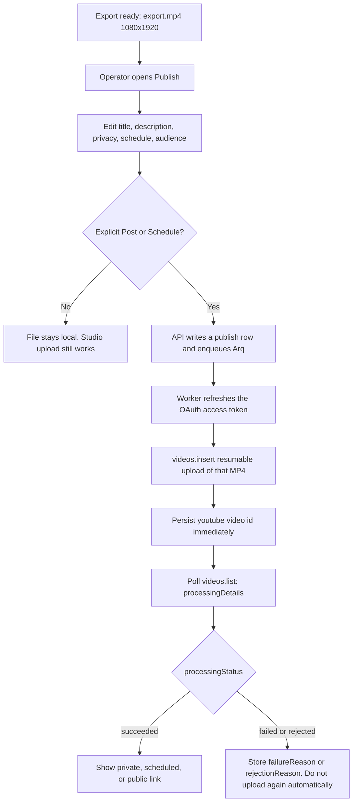

# YouTube publish automation — R&D

**Workspace:** `/Users/apple/Desktop/Cliping`  
**Research date:** 14 November 2026  
**Decision this unblocks:** After a clip is exported, can Cliping post that file to the operator’s own YouTube channel, and what flow is required?  
**Status:** Research. The playbook is [plans/PHASE_6_YOUTUBE_PUBLISH.md](./plans/PHASE_6_YOUTUBE_PUBLISH.md); the end-to-end autopilot flow and Gemini metadata are in [AUTOPILOT_RND.md](./AUTOPILOT_RND.md).

---

## Verdict

Yes. The supported path is the **YouTube Data API v3** method `videos.insert`, using Google’s **resumable upload** protocol, with an OAuth token for the channel owner. There is no separate Shorts upload API. YouTube classifies the upload itself: a square or vertical file up to **3 minutes**, uploaded on or after 15 October 2024, is a Short. Cliping already exports **1080×1920 H.264/AAC MP4**, so a clip at or under 3 minutes meets that rule.

The automation that fits this product is **approve, then upload**. Export finishing must not publish anything. The operator edits the title and description, chooses privacy, and explicitly posts or schedules. The worker then uploads that exact `export.mp4`. Default the first version to **private** (or a scheduled private video). Public is a choice on that screen, not a pipeline default.

A personal channel does not need a paid vendor, a service account, or browser automation of YouTube Studio. The default project quota is **100 `videos.insert` calls per day**, which covers personal clipping volume. The clipping pipeline stays local; only the upload call needs Google.

---

## Options compared

| Option | Fit for Cliping | Cost | Local? | Risk |
| --- | --- | --- | --- | --- |
| **YouTube Data API `videos.insert` (resumable)** from the Arq worker | Matches the stack. Uses the file we already encode. Official, documented, quota-bounded. | $0 API usage. One Google Cloud project. Default **100 uploads/day** in its own bucket. | Pipeline stays on disk. The upload is the only required network step. | Refresh-token handling, a double upload if a crash is retried badly, rights if the source is not yours, subscriber spam if notifications stay on. |
| **Download the MP4 and upload in YouTube Studio** | This is the product today. Zero integration. | $0 | Yes | No automation. Keep it as the fallback when the API path is off or fails. |
| **Third-party poster** (Repurpose.io, Buffer, Ayrshare, Upload-Post, and similar) | Same underlying API, hidden behind a vendor. | Monthly subscription. The vendor holds the channel token. | No | Another outage domain and another terms-of-service surface. Fights the local-first default. |
| **Drive YouTube Studio in a browser** | Looks like automation. | $0 | Local | Fragile UI, and it is not the supported integration. Account risk. Do not build. |
| **Session cookies or undocumented upload endpoints** | Not a product path. | — | — | Account loss, no contract, no error model. Do not build. |
| **Google service account** | Does not attach to a normal channel. | — | — | Official result is `youtubeSignupRequired` / no linked channel. Content-owner delegation is a different product (CMS partners). Do not use for this app. |

---

## Recommendation

Build this only as a **later phase after Phase 4**, behind env flags, for **one operator and one channel**. Keep human review. Keep the feature off when YouTube credentials are absent, so the clipper still runs with no cloud keys.

**Ship in that phase**

1. A one-time **Connect YouTube** action (OAuth, loopback redirect, offline refresh token).
2. A publish sheet over the whole gallery of `ready` exports: per-clip title and description (Gemini drafts from Phase 5, editable), privacy, optional spaced schedule, audience flag, synthetic-media flag, one Post button for the batch.
3. An Arq job, separate from `export`, that resumable-uploads `export.mp4` and stores the YouTube video id before it does anything else.
4. A status line: uploading → processing → private / scheduled / public, plus the Studio link.
5. `notifySubscribers=false` unless the operator checks it on that post.

**Leave out of that phase**

- Posting when a proposal or export finishes, with no click.
- TikTok, Instagram, LinkedIn, or a calendar product.
- Analytics pull (`videos.list` statistics) and any ranking feedback loop.
- Playlists, end screens, cards, Community posts, or a custom thumbnail, until the plain upload is reliable. Thumbnail rules are below; they are a follow-up, not the first slice.
- A YouTube quota-extension audit. Personal volume fits the default 100 uploads/day.
- Multi-user “connect your channel” SaaS. That needs Google OAuth verification and a YouTube API compliance audit, which this personal box does not need on day one.

**Library:** `google-api-python-client` plus `google-auth-oauthlib` inside `services/api`. Let the client run the resumable protocol. Hand-rolled byte loops are how sessions get leaked or retried into a second video.

**Worker note:** Compose runs Arq with `max_jobs=1`. A publish occupies that slot until the upload returns. For a minute-long Short that is acceptable. Do not raise worker concurrency just to overlap uploads with Whisper.

---

## Required flow

What the operator does once, before any of that:

1. In Google Cloud, create a project and enable **YouTube Data API v3**.
2. Configure the OAuth consent screen. Add the Google account that owns the channel as a test user while the app is in Testing.
3. Create an OAuth client whose redirect URI is the local callback (loopback on the API or the Next app). Put the client id and secret in env, not in git.
4. In Cliping, click **Connect YouTube**, sign in, and choose the channel. If the Shorts channel is a **Brand Account**, pick that Brand Account in Google’s chooser. `videos.insert` has no channel-id parameter for a normal user. The video lands on the channel the token represents.
5. Move the consent screen to **In production** after the first successful private upload, so the refresh token is not stuck on the 7-day Testing lifetime. The owner can click through the unverified-app warning for their own app. A public multi-user product is a different bar (verification plus a YouTube audit) and is out of scope here.

Token request: `access_type=offline` and, on first connect, `prompt=consent`, or Google may omit the refresh token. Scope for the first slice: `https://www.googleapis.com/auth/youtube.upload`. That scope is enough for `videos.insert`. Official `thumbnails.set` docs list the same scope; confirm on the first thumbnail experiment rather than requesting `youtube` or `youtube.force-ssl` up front. Those wider scopes can delete videos and comments.

Store the refresh token under the data directory, mode restricted to the operator, gitignored. Log the video id and error reason. Do not log the refresh token, the access token, or the resumable session URI.

---

## What already exists, and what publish adds

| Already in Cliping | Publish still needs |
| --- | --- |
| Human accept, then a separate export job | A third job kind, `publish`, which runs only after export is `ready` |
| `export.mp4` at 1080×1920, H.264 + AAC, burned captions | Send that file. Do not re-encode in the publish job |
| Clip title the operator can edit | A YouTube title, max **100** characters, no `<` or `>` |
| Local-first pipeline, no required cloud key | Optional env: client id, client secret, feature off when unset |
| “Never auto-publish” in the phase rules | The same rule: the button is the gate |

Suggested row, when a phase is written (shape only, not a migration to apply now):

| Field | Purpose |
| --- | --- |
| `clip_id`, `export_id` | Which file was sent |
| `export_hash` | Skip a second upload when this exact export was already accepted by YouTube |
| `youtube_video_id` | Written as soon as the insert response arrives |
| `session_uri` | Resume one interrupted upload. A new session creates a second video and spends a second daily insert |
| `privacy_status` | `private`, `unlisted`, or `public` |
| `publish_at` | Set only with `privacy_status=private`, on a video that has never been public |
| `notify_subscribers` | Default false |
| `status` | `queued`, `uploading`, `processing`, `scheduled`, `live`, `failed` |
| `error_code` | API reason: `invalidTitle`, `uploadLimitExceeded`, `copyright`, `duplicate`, `transcodeFailed`, and the rest of the official lists |

Idempotency rule: if `youtube_video_id` is already stored for this export hash, the job returns that id. If the process dies after YouTube has the bytes, resume the saved session URI. The resumable protocol returns the original result when the upload already finished. Starting a fresh `videos.insert` is the bug that double-posts.

---

## Metadata to send

Set these on the insert body (`part=snippet,status`):

| Field | Rule for Cliping |
| --- | --- |
| `snippet.title` | Clip title, trimmed to 100 characters. Required and non-empty. Characters `<` and `>` are invalid. |
| `snippet.description` | Operator-edited text, max **5000 bytes**, same character ban. A draft can start from the clip’s caption text plus a line pointing at the full episode **when the operator owns that episode**. Do not auto-append hashtag spam. |
| `snippet.tags[]` | Optional. The whole list, including commas between tags, max **500** characters. A tag with a space is counted as if it were quoted. |
| `snippet.categoryId` | Default **22** (People & Blogs) only after `videoCategories.list` for the channel region still returns 22. That call costs 1 unit in the shared bucket. An invalid id returns `invalidCategoryId`. |
| `snippet.defaultLanguage` | Set when the transcript language is known (for example `en`). Required if localized titles are sent. Skip localizations in v1. |
| `status.privacyStatus` | UI default **private**. Omitting it makes the API default **public**. |
| `status.publishAt` | ISO 8601, only together with `privacyStatus=private`, and only if the video has never been published. A timestamp in the past publishes immediately. `videos.update` must send `privacyStatus=private` again when changing `publishAt`. |
| `status.selfDeclaredMadeForKids` | The operator must choose. Store a channel-level default after the first explicit choice. Do not infer this from the transcript. |
| `status.containsSyntheticMedia` | Default **false** for a crop and burned captions of real footage. Google’s examples are a real person made to say something they did not say, altered footage of a real event, or a realistic scene that did not occur. A later AI voice or face replacement means the operator sets this **true**. |
| `notifySubscribers` | Query parameter, default on YouTube’s side is **true**. Cliping sends **false** unless the operator asks to notify on that one video. A batch of ten Shorts should not email subscribers ten times. |

Captions are already burned into the picture. A sidecar `captions.insert` is optional later (about **400** units) and is not required for the Short to be readable.

---

## Shorts rules that change the product

| Rule | Source of truth | What Cliping should do |
| --- | --- | --- |
| Square or vertical, **≤ 3:00**, uploaded on or after 15 October 2024 → categorized as a Short | YouTube Help, three-minute Shorts | 1080×1920 exports qualify on shape. If duration is over 180 seconds, tell the operator it will be a normal video. There is no API flag to force or prevent Shorts. Wider than tall is how you stay long-form. |
| `#Shorts` in the title | Not the classification mechanism | Do not require the hashtag. |
| A Short **over 60 seconds** with any active copyright claim, including a manual claim, is **blocked globally** (unplayable, not recommended, not monetizable). No channel strike from that block. Claims on Shorts **under** 60 seconds follow the older music rules. | YouTube Help, three-minute Shorts and music eligibility | Prefer clips ≤ 60 seconds when the source may contain claimed music. Surface a warning on 61–180 second exports. Owned talking-head with no third-party music is the safe case. |
| Custom thumbnail on a Short | `thumbnails.set` docs | Call it only after `processingDetails.processingStatus` is `succeeded`. Earlier calls can be ignored. JPEG or PNG, max 50 MB, about **50** quota units. The channel must already be allowed to upload custom thumbnails, or the API returns `403 forbidden`. `429 uploadRateLimitExceeded` means back off. Skip thumbnails in the first slice; Shorts often show a frame in the feed anyway. |
| Reused / inauthentic content | YouTube monetization and spam policies (see [CLIPPING_RND.md §1](./CLIPPING_RND.md)) | Posting every proposal, unchanged, can look like mass reupload. The review gate is the mitigation. Rights stay the operator’s. |

`status.uploadStatus` after a successful HTTP insert is often `uploaded`, then `processed`. Rejection reasons include `claim`, `copyright`, `duplicate`, `inappropriate`, `legal`, `length`, `termsOfUse`, `trademark`, `uploaderAccountClosed`, `uploaderAccountSuspended`. Upload failure reasons include `codec`, `conversion`, `emptyFile`, `invalidFile`, `tooSmall`, `uploadAborted`. Processing failure reasons include `transcodeFailed`, `uploadFailed`, `streamingFailed`, `other`. Show the reason. Do not blind-retry a `duplicate` or a `copyright` rejection.

Poll `videos.list` with `part=status,processingDetails` a handful of times, not in a tight loop. Each call costs **1** unit in the shared 10,000-unit bucket.

---

## Quota, auth lifetime, and money

Official quota page (fetched 14 November 2026):

| Bucket | Default per day | Cost that matters here |
| --- | --- | --- |
| `videos.insert` | **100 calls**, its own bucket | **1** per upload, including a failed call |
| `search.list` | 100 calls, its own bucket | Cliping should not call search for this feature |
| Every other method | **10,000 units** combined | `videos.list` 1, `videos.update` 50, `thumbnails.set` 50, `playlistItems.insert` 50, `captions.insert` 400, `videoCategories.list` 1 |

Quotas reset at **midnight Pacific Time**. Ten Shorts in a day are about 10 insert calls plus a few list polls. That fits the default. More than 100 uploads a day requires the **YouTube API Services audit and quota extension** form. Do not file that for a personal channel.

Older write-ups still say one upload costs ~1,600 units and that an unverified project can only upload as **private**. The insert reference, last updated **2026-11-12 UTC**, says a call costs **1** unit in the video-uploads bucket and that **“videos uploaded from unverified API projects are not restricted to private viewing mode.”** Account settings can still force new uploads to private. Cliping should default its own UI to private anyway, because the API’s default when the field is omitted is **public**.

Auth constraints that are easy to get wrong:

| Fact | Practical effect |
| --- | --- |
| An API key cannot upload. Insert, update, and delete need a user OAuth token. | Connect is a browser consent, once. |
| Service accounts work only for YouTube content owners using `onBehalfOfContentOwner`. | Useless for a normal or Brand Account channel. |
| External consent screen left in **Testing** | Refresh tokens expire after **7 days** (unless the only scopes are profile/email). Fine for a first private test. Wrong for an unattended week. |
| Consent screen **In production**, still used by the owner | Refresh tokens last until revoked, unused for six months, or pushed out by the **100 refresh tokens per Google account per client** cap. Requesting a new token on every click without storing it will invalidate older ones. |
| Access token lifetime | About one hour. The worker refreshes from the stored refresh token. |
| `youtube.upload` | Narrow scope: upload and manage videos. Prefer it over `youtube`, which can manage the whole account. |

Channel-level `uploadLimitExceeded` is separate from project quota. Google does not publish one fixed “N videos per channel per day” in the API docs. New or low-standing channels hit it sooner. When it returns, stop the queue and surface the error. Do not rotate projects or accounts to get around it.

---

## Rights and product constraints

This is not legal advice. It matches [CLIPPING_ARCHITECTURE.md §1](./CLIPPING_ARCHITECTURE.md).

- Upload **media the operator has the right to post**. A clip of someone else’s video, even with credit, is a copyright and Content ID problem. Re-uploading raises that risk.
- URL ingest via yt-dlp stays a convenience with a disclaimer. Connecting YouTube for **upload** does not make downloading other people’s videos an official API feature. The Data API still has no “give me the MP4” method.
- Music under the voice is the usual claim. On a 61–180 second Short, any active claim blocks the video globally.
- The publish sheet should repeat the existing rights line: the operator is responsible for this post.

---

## Failure handling

| Situation | Behavior |
| --- | --- |
| Export missing or not `ready` | Refuse to enqueue. |
| No refresh token | Send the operator back to Connect. Do not fall back to a browser bot. |
| Network drop or HTTP 500 / 502 / 503 / 504 during upload | Resume the same session URI with exponential backoff. Session URIs expire, so resume promptly. If the session is dead and no video id was stored, the operator retries once. |
| HTTP 403 `quotaExceeded` on insert | Stop the queue until the Pacific reset. Show the count used if the Cloud console is the only place that knows it. |
| HTTP 400 `invalidTitle`, `invalidDescription`, `invalidTags`, `invalidPublishAt`, `invalidCategoryId` | Fail that row. Keep the file. Let the operator edit and retry. |
| `rejectionReason` `duplicate` | Point at the existing video if the id was stored. Do not upload a third copy. |
| `rejectionReason` `copyright` or `claim` | Stop. Link YouTube Studio. Do not strip audio automatically in this phase. |
| Worker killed after a video id exists | Mark processing and poll. Do not insert again. |
| Operator disconnects the app in their Google Account | Next refresh fails. Show Connect again. Leave already-posted videos alone. |

---

## Open questions before a phase playbook

1. **Privacy default in the UI:** resolved for Phase 6 — default is a spaced schedule (private + `publishAt`), with “all public now” as a visible choice.
2. **Schedule grid:** one `publishAt` per clip is enough. A weekly calendar is a later product.
3. **Description draft:** resolved — Gemini drafts title, description, and hashtags in Phase 5; the operator sees and can edit the exact text before Post ([AUTOPILOT_RND.md](./AUTOPILOT_RND.md)).
4. **`channels.list?mine=true` under only `youtube.upload`:** confirm during implementation whether that scope returns the channel title. If it 403s, the upload can still proceed and the UI can say “connected” without a name, or add `youtube.readonly` in a second consent.
5. **`playlistItems.insert` scope:** not verified in this pass. Add playlists only after checking the official auth table. Do not widen the scope on a guess.
6. **Brand Account vs personal channel:** the connect screen must say which channel the token will post to, once that call works.

---

## Sources

Accessed **14 November 2026**.

- [Videos: insert](https://developers.google.com/youtube/v3/docs/videos/insert) — upload method, scopes, settable fields, errors, quota wording. Page last updated 2026-11-12 UTC.
- [Video resource](https://developers.google.com/youtube/v3/docs/videos) — title 100 characters, description 5000 bytes, tags 500 characters, `publishAt`, `selfDeclaredMadeForKids`, `containsSyntheticMedia`, `uploadStatus`, `processingStatus`.
- [Resumable uploads](https://developers.google.com/youtube/v3/guides/using_resumable_upload_protocol) — session start, 5xx resume, session lifetime.
- [Quota calculator](https://developers.google.com/youtube/v3/determine_quota_cost) — 100 `videos.insert`/day at 1 unit, 10,000-unit shared bucket, per-method costs.
- [Quota and compliance audits](https://developers.google.com/youtube/v3/guides/quota_and_compliance_audits) — audit required only to exceed the default allocation.
- [Thumbnails: set](https://developers.google.com/youtube/v3/docs/thumbnails/set) — wait for `processingStatus=succeeded` on Shorts; 50-unit cost; 403 and 429.
- [OAuth 2.0 for Google APIs](https://developers.google.com/identity/protocols/oauth2) — 7-day refresh tokens while an external app is in Testing; refresh-token limits.
- [OAuth for YouTube web server apps](https://developers.google.com/youtube/v3/guides/auth/server-side-web-apps) — scope list; service accounts only for content owners; `access_type=offline` to receive a refresh token.
- [Move from ClientLogin to OAuth](https://developers.google.com/youtube/v3/guides/moving_to_oauth) — service accounts cannot own a normal channel (`youtubeSignupRequired`).
- [Understand three-minute YouTube Shorts](https://support.google.com/youtube/answer/15424877) — vertical or square, ≤ 3 minutes, claim block over 60 seconds.
- [Upload YouTube Shorts on a computer](https://support.google.com/youtube/answer/12779649) — Studio path: up to 3 minutes, square or vertical.
- [Music eligibility for YouTube Shorts](https://support.google.com/youtube/answer/13486873) — claims on 1–3 minute Shorts.

Third-party quota articles that still cite a 1,600-unit upload cost or a private-only lock on unverified projects were **not** used as fact where they disagree with the official pages above.
